# Scrutiny & Refined Implementation Plan: Publication-Ready Figure Captions

This implementation plan provides a rigorous, visual-inspection-verified critique and enhancement of all figure legends in [manuscript.md](file:///d:/W/serratia-research/manuscript/manuscript.md). Every detail has been verified directly against the rendered figure files in the `manuscript/` directory, including both DRAM panels (**Figure 3A** & **Figure 3B**).

---

## 1. Visual Verification & Scrutiny of Figure Files

| Figure | Source File(s) | Key Visual Details Verified from Raw Images |
| :--- | :--- | :--- |
| **Figure 1** | `Figure1_SM-NMZ.png`<br>`Figure1_C14-NMZ.png` | Center text identifies SM-NMZ as *S. marcescens* (2 sequences: chromosome + plasmid, 5.0 Mbp) and C14-NMZ as *S. nematodiphila* (1 chromosome, 5.1 Mbp). Concentric rings: (1) Outermost scale in Mbp with `oriC` origin; (2 & 3) Forward and reverse strand CDS (gray), tRNA (light green), rRNA (coral), ncRNA (orange), ncRNA reg (blue), CRISPR (purple); (4) GC content (+ green, − red); (5) GC skew (+ orange, − blue). |
| **Figure 2** | `Figure2_SM-genome-phylogram.png`<br>`Figure2_C14-genome-phylogram.png` | TYGS GBDP/FastME phylograms showing bootstrap support percentages (64–100%). SM-NMZ clusters with *S. marcescens* subsp. *sakuensis* KCTC 42172 / ATCC 13880; C14-NMZ clusters with *S. nematodiphila* DSM 21420. Outgroups: *Dryocola clanedunensis*, *Klebsiella trevisanii*, *Enterobacter pasteurii*. Right columns display species/subspecies clusters, G+C delta statistics, genome size, protein count, and user strain indicator (+). |
| **Figure 3A & 3B** | `Figure3_DRAM.jpeg`<br>`Figure3_DRAM2.jpeg` | **(A) Central Metabolism & ETC**: Heatmap displaying `% Complete` (0.0 pale yellow to 1.0 dark blue) across 14 genomes for central carbon modules (Glycolysis, Entner-Doudoroff, Pentose phosphate, TCA cycle, Glyoxylate shunt, Wood-Ljungdahl) and ETC Complexes (I, II, III, IV High-affinity bd/cbb3, IV Low-affinity aa3/o, V F/V-type ATPases).<br>**(B) Auxiliary & Specialized Pathways**: CAZy carbohydrate degradation (cellulose, starch, pectin, arabinan), Nitrogen metabolism (nitrate reduction to nitrite), Sulfur metabolism (tetrathionate reduction), Other Reductases (arsenate reduction), Photosynthesis (negative control), and Methanogenesis/methanotrophy modules. |
| **Figure S1** | `Figure4_vf_heatmap.jpg` | Virulence Factor Database (VFDB / `VF_classifier`) heatmap comparing sequence identity (0–100%, white to dark blue) across the 14-genome panel. Grouped by 12 Broad Categories (Adherence, Effector delivery, Exotoxin, Motility, Iron acquisition, etc.) and 60+ Specific Mechanisms (T6SS-I/II/III, Flagella, Hemolysin ShlA-ShlB, HasA hemophore, Aerobactin, Enterobactin, Pyoverdine, etc.). The profile provides comparative genomic context and is not a standalone biosafety assessment. |
| **Figure 5** | `Figure5_Bubbles-Subpathways-HADEG.png` | Curated HADEG marker-gene bubble plot across 14 genomes. Categorized into 4 compound classes: **A_Alkanes** (dark blue: hydrocarbon uptake, alkane auxiliary genes, terminal/biterminal oxidation, Finnerty pathway), **C_Aromatics** (yellow: phenylacetate, homoprotocatechuate, protocatechuate, catechol ortho/meta, benzoate, gallate, gentisate), **D_Biosurfactants** (orange: emulsan, serrawettin), and **E_Plastics** (red: P3HV/PHA/PHBV, PU). Bubble diameter indicates gene hit counts (1 to 6); the plot represents genomic marker distribution rather than demonstrated pathway activity. |
| **Figure 6** | `Figure6_serrawettin.jpeg` | `clinker` gene synteny (2.5 kb scale) across 9 representative genomes showing the serrawettin-associated non-ribosomal peptide synthetase (*swrW*, orange arrow), flanked by conserved operon members (*msrP-msrQ-aroQ-accBC*, *lld-Smc-MFS*, *yhdT-panF-prmA*, *dusB-fis*, *lpxOP-pyrG* upstream; *IrgBA-lysR-nhaP*, *transporter-gstA-lipocalin-fabG-SSB1-uvrA-adhP-maa-tyrB* downstream). The red culture phenotype and LC-HRMS profiling detected serrawettin W1 and serratamolide C; connecting colored linkages represent pairwise amino-acid sequence identity. |
| **Figure 7** | `Figure7_prodigiosin.jpeg` | `clinker` synteny diagram (2.5 kb scale) across 9 genomes illustrating the 14-gene prodigiosin-associated *pig* arrangement (*pigA*–*pigN*, colored block arrows), flanked by upstream regulatory/transport genes (*dacB*, *ybak*, *traB*, *copZ*) and downstream loci (*cueR*, *ybbJ*, *hflC*, *cfa*, *cnoX*, *allSAR*, *GCL*). The red culture phenotype and LC-HRMS profiling, with serrawettin W1 and serratamolide C detected, provide experimental confirmation of the serrawettin- and prodigiosin-associated metabolite phenotype under the tested conditions. |
| **Figure 8** | `Figure8_LadA-validation-phylotree.svg` | Radial maximum-likelihood phylogenetic tree (IQ-TREE 3, `Q.PFAM+R3` model) placing candidate monooxygenases from SM-NMZ and C14-NMZ relative to reference enzymes: LadA alpha (`BAM76377.1`), canonical LadA (`A4IU28`), LadA beta (`BAM76372.1`), LadB (`BAM76371.1`), DszA (`P54995`), NtaA (`P54989`), and SsuD (`P80645`, `A4W8V4`). The candidate sequences fall within a LadA-associated sequence clade; report branch-support values and do not treat placement as biochemical proof. |
| **Figure 9** | `Figure9_LadA-cluster-curated.jpeg` | `clinker` micro-synteny alignment (2.5 kb scale) of a candidate *ladA*-associated genomic neighborhood across 10 *Serratia* genomes. Annotates the flavin-dependent monooxygenase-like core (*ssuD* / *ladA* homolog pair, salmon arrows), upstream methionine/sulfur transport (*metQPN*, *prop*, *MFS*, *wrbA*, *nfnB*, *nac*, *mtnN*), and downstream regulators and alkane-associated genes (*atoC*, *glnG*, *nikD*, *ddpABCD*, *nhaP*, *lysR*, *alkB*, *rarD*, *dhbA*). Conserved neighborhood does not establish biochemical activity or substrate turnover. |

---

## 2. Refined, Publication-Ready Figure Captions for `manuscript.md`

### Figure 1
```markdown
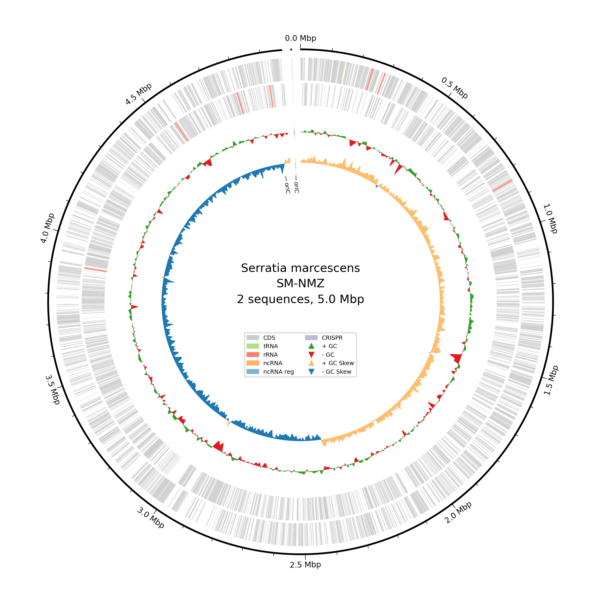
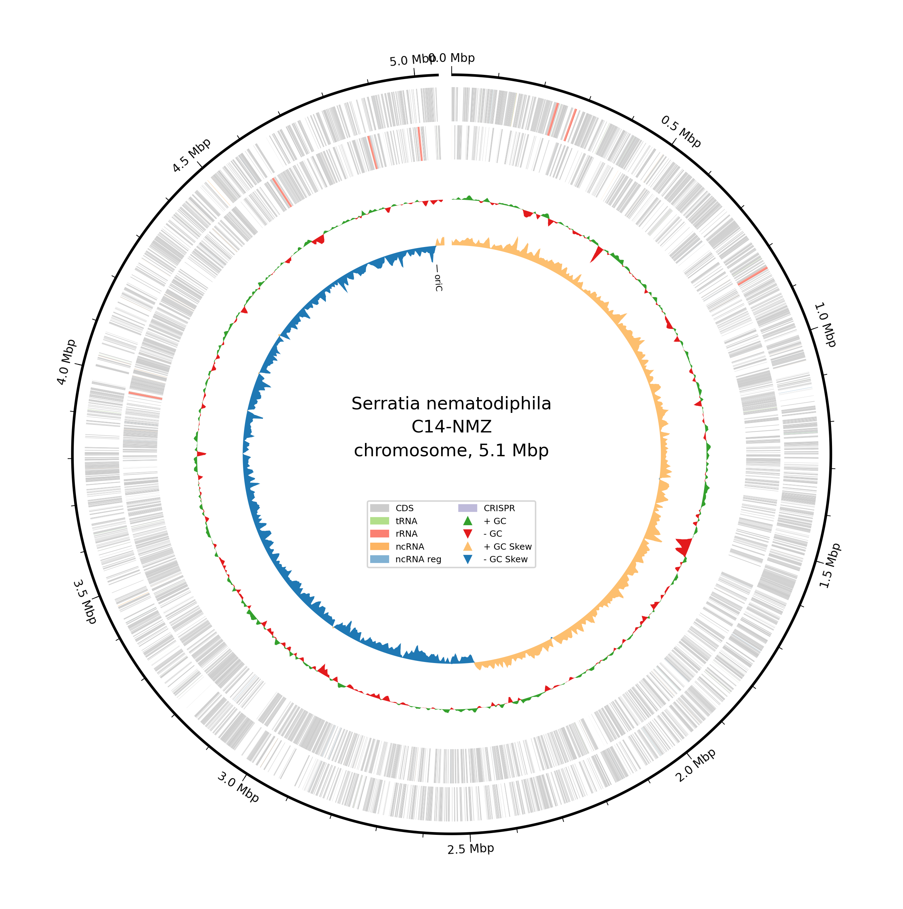
**Figure 1. Circular genomic feature maps of *Serratia* isolates.**
Bakta-annotated circular representations of **(A)** *Serratia* sp. SM-NMZ (5.0 Mbp, comprising the circular chromosome and a ~3.5 kb circular plasmid) and **(B)** *Serratia* sp. C14-NMZ (5.1 Mbp circular chromosome). Concentric rings from outside to inside display: (1) Genomic coordinate markers (Mbp) with `oriC` origin of replication; (2) Forward-strand coding sequences (CDS, gray); (3) Reverse-strand CDS (gray), with highlighted structural and non-coding RNA features including tRNA (light green), rRNA (coral), ncRNA (orange), regulatory ncRNA (blue), and CRISPR arrays (purple); (4) GC content plot (+ deviation in green, − in red); and (5) GC skew plot (+ skew in light orange, − skew in blue).
```

### Figure 2
```markdown
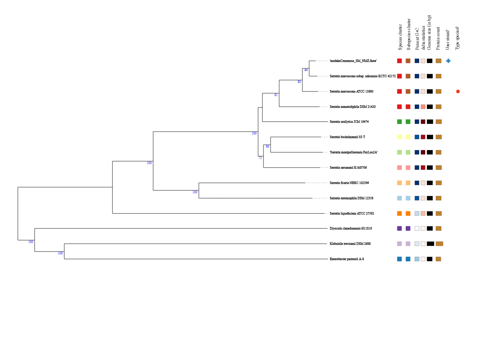
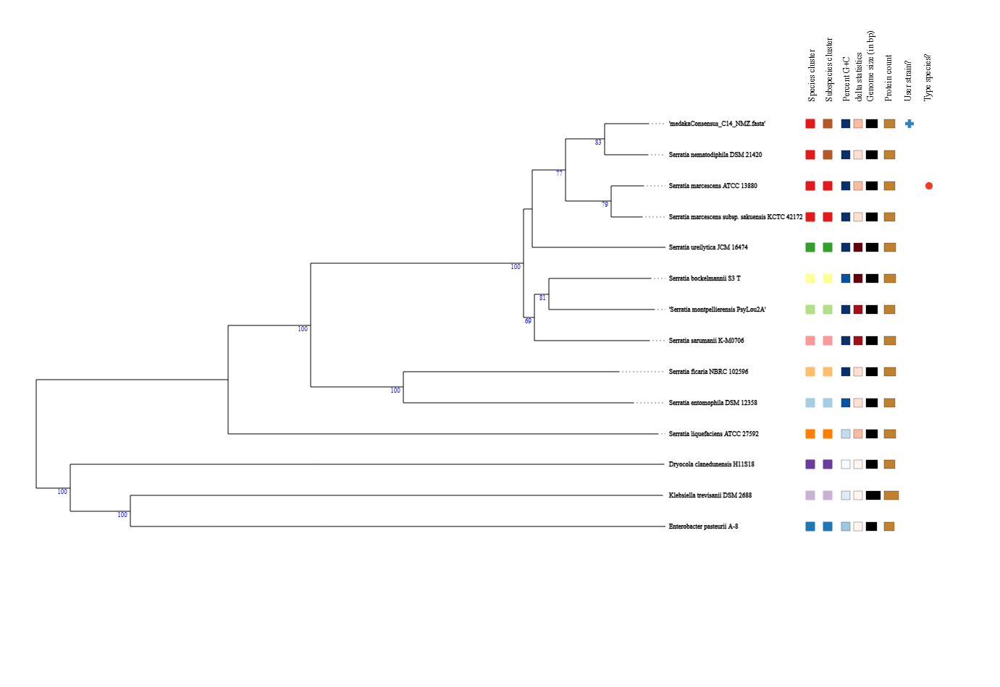
**Figure 2. Whole-genome comparative phylograms for isolates SM-NMZ and C14-NMZ.**
Phylograms auto-constructed by the Type (Strain) Genome Server (TYGS) using the Genome BLAST Distance Phylogeny (GBDP) approach and FastME, with branch support based on 100 pseudo-bootstrap replicates, show **(A)** *Serratia* sp. SM-NMZ within the *Serratia marcescens* species/subspecies cluster alongside type strain ATCC 13880^T^ and subsp. *sakuensis* KCTC 42172^T^ and **(B)** *Serratia* sp. C14-NMZ near *Serratia nematodiphila* DSM 21420^T^. Right-hand columns denote species/subspecies cluster groupings, % G+C delta statistics, genome size, protein count, and user strain designation (+).
```

### Figure 3 (Panels A and B)
```markdown
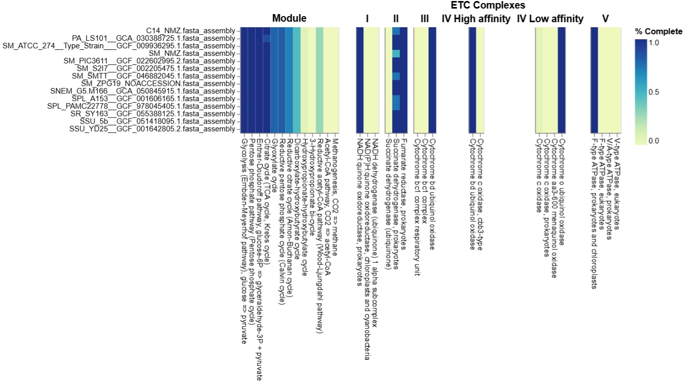
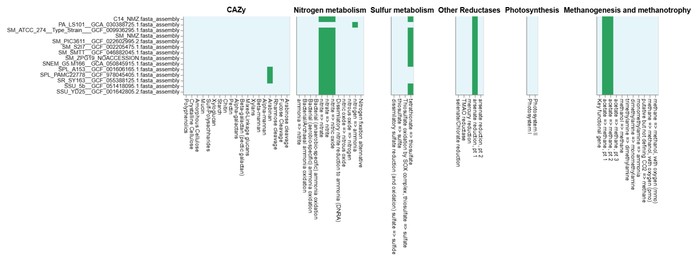
**Figure 3. Distillation of central and specialized microbial metabolism across comparative *Serratia* genomes (DRAM).**
Functional pathway distillation heatmaps generated by DRAM across 13 *Serratia* genomes and the *Prodigiosinella aquatilis* PA-LS101 outgroup. Color bar indicates percentage module completeness ranging from 0.0 (pale yellow) to 1.0 (dark green/blue). **(A)** Central carbon metabolism and respiratory electron transport chain (ETC) complexes, including Glycolysis, Entner-Doudoroff, Pentose Phosphate, Citrate/TCA cycle, Glyoxylate shunt, Reductive Acetyl-CoA pathways, and Complexes I–V (NADH dehydrogenase, Succinate dehydrogenase, Cytochrome bc1, Cytochrome bd/cbb3/aa3 oxidases, and F/V-type ATP synthases). **(B)** Specialized functional categories covering Carbohydrate-Active enZymes (CAZy; cellulose, starch, pectin, arabinan degradation), Nitrogen metabolism (nitrate to nitrite reduction), Sulfur metabolism (tetrathionate reduction), Other Reductases (arsenate reduction), Photosynthesis (negative controls), and Methanogenesis/methanotrophy pathways.
```

### Figure S1 (Supplementary Material)
```markdown
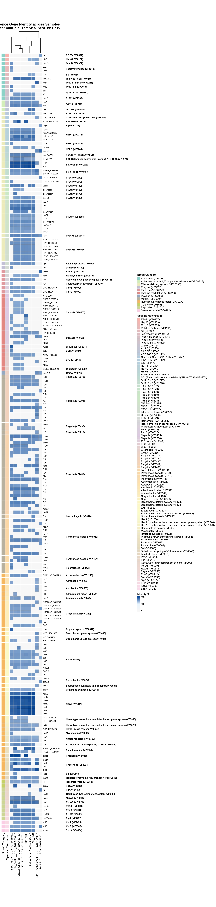
**Figure S1. Comparative virulence-factor landscape of *Serratia* isolates (VFDB / VF_classifier).**
Hierarchically clustered sequence-identity heatmap (0–100%, light to dark blue) of virulence factors identified via `VF_classifier` against the Virulence Factor Database (VFDB) across the 14-genome panel. Genes are grouped by Broad Categories (Adherence, Effector delivery systems, Enzymes, Exotoxins, Immune evasion, Motility, Iron acquisition, and Secretion systems) and Specific Functional Mechanisms (T6SS-I/II/III clusters, flagellar apparatus, hemolysins ShlA–ShlB, HasA hemophore systems, enterobactin, and aerobactin). The profile contextualizes conserved or divergent homologs associated with environmental persistence, motility, and iron acquisition; it does not by itself establish biosafety or exclude pathogenicity islands. (*Designated as Supplementary Figure S1 due to vertical dimension*).
```

### Figure 5
```markdown
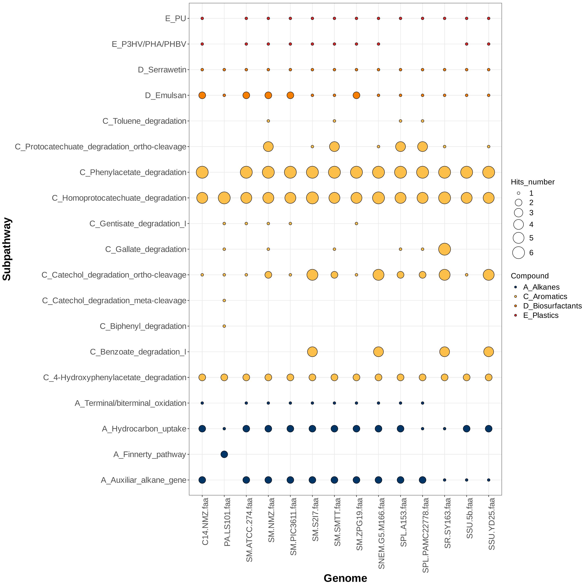
**Figure 5. Genomic repertoire of hydrocarbon-degradation and biosurfactant marker genes (HADEG).**
Bubble plot illustrating the distribution and hit counts of curated aerobic hydrocarbon-degradation marker genes across the 14-genome dataset, representing genomic potential rather than demonstrated pathway activity. Subpathways on the Y-axis are grouped into four major classes: **A_Alkanes** (dark blue circles: hydrocarbon uptake, alkane terminal/biterminal oxidation, and auxiliary alkane-degradation genes), **C_Aromatics** (yellow circles: phenylacetate, homoprotocatechuate, protocatechuate ortho-cleavage, catechol ortho/meta-cleavage, benzoate, and gentisate degradation), **D_Biosurfactants** (orange circles: serrawettin and emulsan biosynthetic loci), and **E_Plastics** (red circles: PU and PHA/PHBV degradation). Bubble diameters correspond to normalized gene-copy hit numbers (1 to 6).
```

### Figure 6
```markdown
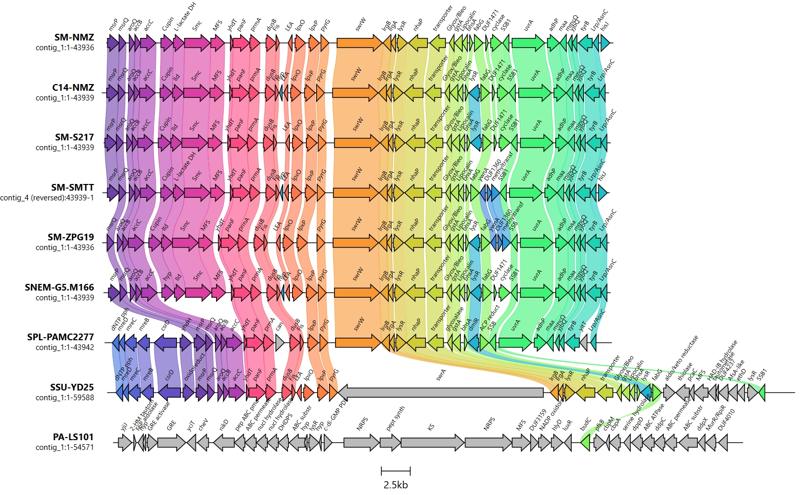
**Figure 6. Genomic synteny and neighborhood architecture of a serrawettin-associated locus.**
Comparative gene-cluster alignment constructed with `clinker` (scale bar = 2.5 kb) detailing the serrawettin-associated non-ribosomal peptide synthetase (*swrW*, orange block arrow) across *Serratia* sp. SM-NMZ, *Serratia* sp. C14-NMZ, and 7 comparative genomes. Flanking conserved genomic architecture highlights upstream cell division/metabolism genes (*msrP*, *aroQ*, *lld*, *Smc*, *MFS*, *yhdT*, *panF*, *dusB*, *fis*, *lpxOP*, *pyrG*) and downstream transport/stress-response operons (*IrgBA*, *lysR*, *nhaP*, *gstA*, *lipocalin*, *fabG*, *SSB1*, *uvrA*, *adhP*, *tyrB*). The red culture phenotype and LC-HRMS profiling detected serrawettin W1 and serratamolide C; connecting colored linkages represent pairwise amino-acid sequence identity.
```

### Figure 7
```markdown
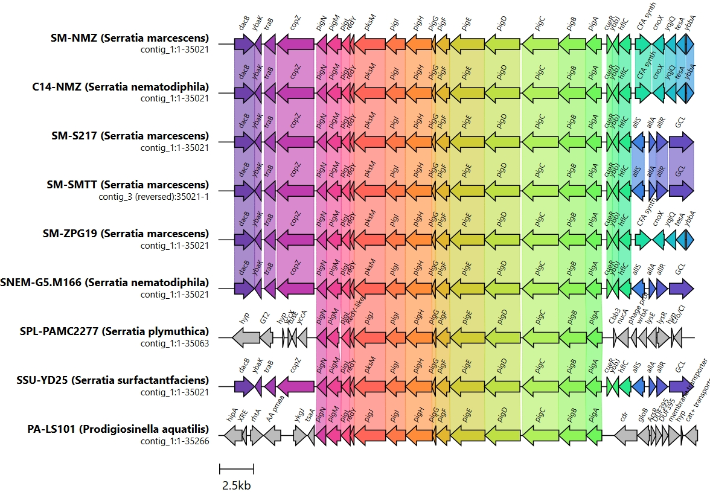
**Figure 7. Syntenic organization of the 14-gene prodigiosin (*pig*) locus.**
Gene-cluster comparison map generated using `clinker` (scale bar = 2.5 kb) illustrating the *pigA*–*pigN* arrangement associated with prodigiosin biosynthesis across SM-NMZ, C14-NMZ, and reference *Serratia* genomes. Arrows represent open reading frames with direction of transcription: *pigA*–*pigE* (proline incorporation and MAP condensation, light green), *pigF*–*pigH* (MBC biosynthesis, orange), *pigI*–*pigN* (condensing and tailoring enzymes, pink/red). Flanking boundaries show conserved upstream (*dacB*, *ybak*, *traB*, *copZ*) and downstream (*cueR*, *ybbJ*, *hflC*, *cfa*, *allSAR*) loci. The red culture phenotype and LC-HRMS profiling, with serrawettin W1 and serratamolide C detected, provide experimental confirmation of the serrawettin- and prodigiosin-associated metabolite phenotype under the tested conditions alongside the conserved *pig* arrangement.
```

### Figure 8
```markdown

**Figure 8. Maximum-likelihood phylogram placing candidate LadA-family flavin-dependent monooxygenases.**
Radial unrooted phylogenetic tree inferred with IQ-TREE 3 under the `Q.PFAM+R3` substitution model (determined by ModelFinder via BIC) based on MAFFT (L-INS-i) alignment and ClipKIT trimming. Candidate monooxygenases identified in *Serratia* sp. SM-NMZ (`NNLMDO_015255`) and *Serratia* sp. C14-NMZ (`OJMJKD_015520`) fall within a LadA-associated sequence clade alongside canonical long-chain alkane monooxygenase LadA from *Geobacillus thermodenitrificans* NG80-2 (`A4IU28`) and LadA alpha from *Geobacillus thermoleovorans* B23 (`BAM76377.1`), distinct from reference clades comprising DszA dibenzothiophene monooxygenases (`P54995`, `Q0ZIH7`), NtaA nitrilotriacetate monooxygenases (`P54989`), SsuD alkanesulfonate monooxygenases (`P80645`, `A4W8V4`), and bacterial luciferases. Report the relevant branch-support values; this sequence-level placement does not establish biochemical activity, substrate specificity, or alkane turnover.
```

### Figure 9
```markdown
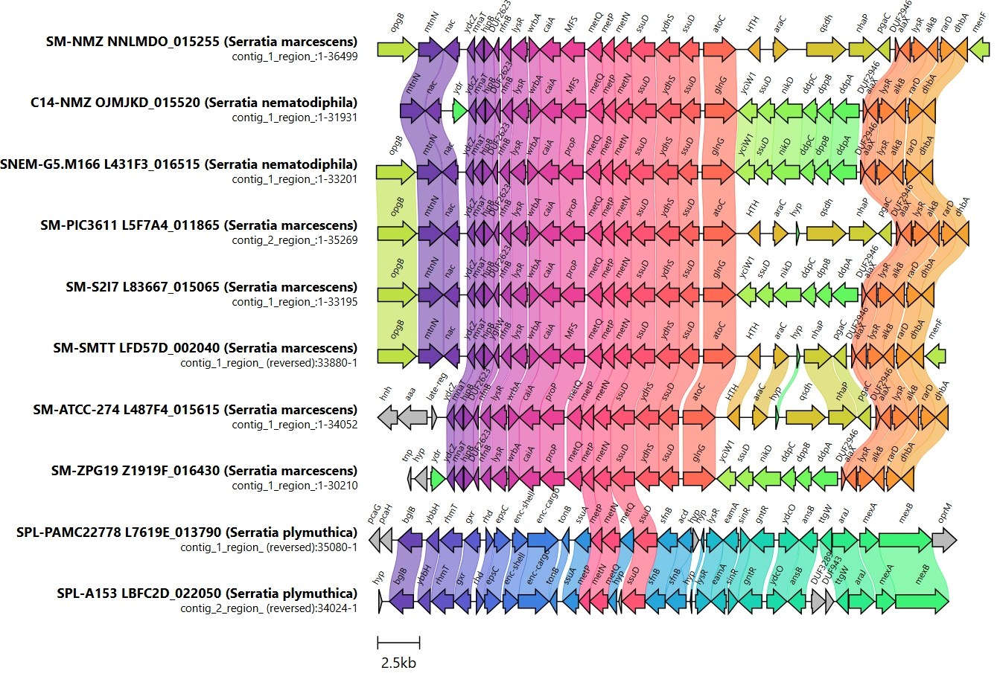
**Figure 9. Micro-synteny and genomic neighborhood of a candidate *ladA*-associated locus.**
Curated genomic synteny alignment (`clinker`, scale bar = 2.5 kb) surrounding the *ladA*-associated locus across 10 *Serratia* genomes. Highlights the flavin-dependent monooxygenase-like core gene pair (*ssuD* / *ladA* homolog and *ydhS*, pink arrows) in SM-NMZ (`NNLMDO_015255`) and C14-NMZ (`OJMJKD_015520`), accompanied by upstream sulfur/methionine uptake transport systems (*metQPN*, *prop*, *MFS*, *wrbA*, *nfnB*, *nac*, *mtnN*) and downstream regulatory/alkane-adaptation genes (*atoC*, *glnG*, *nikD*, *ddpABCD*, *nhaP*, *alkB*, *rarD*, *dhbA*). Syntenic linkage bands indicate pairwise amino acid sequence identity; locus conservation does not establish biochemical activity or substrate turnover.
```

---

## 3. Proposed Changes

### [MODIFY] [manuscript.md](file:///d:/W/serratia-research/manuscript/manuscript.md)
- Replace lines containing brief figure captions in `manuscript.md` with the fully scrutinized, publication-grade legends above (including both `Figure3_DRAM.jpeg` as Figure 3A and `Figure3_DRAM2.jpeg` as Figure 3B).

---

## 4. Verification Plan

### Scripted Verification
- Re-run the citation check used for the manuscript (or an equivalent local script) after any reference edits to guarantee a 1:1 match between all 35 inline citations and the alphabetized reference list.
