# Manuscript
## Materials & Methods
### A. Whole Genome Sequencing
Both isolates were subcultured by streaking onto fresh NA plates until single colonies appeared. A single colony was then transferred into Nutrient Broth and incubated for ~16–24 hours. Cells were harvested by centrifugation, and genomic DNA (gDNA) was extracted using the GeneAid Presto Mini gDNA Bacteria Kit. The purity and concentration of the extracted gDNA were assessed with an Implen NP80 NanoPhotometer. Approximately 200 ng of DNA was used for library preparation with the Rapid Barcoding Kit 24 V14 (SQK‑RBK114.24), followed by loading onto a PromethION flow cell (Oxford Nanopore Technologies, ONT). Sequencing was performed using MinKNOW software for ~28 hours with the dna_r10.4.1_e8.2_400bps_sup@v5.0.0 basecalling model, with adapters and barcodes automatically detected and trimmed. The resulting raw fastq.gz files were stored and concatenated into a single fastq.gz file on the PromethION DAU computer.
### B. De Novo Assembly and Genome Annotation
Raw reads (fastq.gz) were quality‑assessed using NanoPlot [10] (NanoPlot ‑t 24 ‑c green --fastq merged‑fastq.gz ‑o NanoPlot‑isolateID --loglength --plots dot --N50). Reads were first filtered with Chopper [9] (pigz ‑dc merged‑fastq.gz | chopper ‑q 10 ‑l 500 | pigz > filtered‑reads.fastq.gz), then further refined using Filtlong [32] (filtlong --keep_percent 90 filtered‑reads.fastq.gz | pigz > filt‑reads.fastq.gz). Filtered reads were iteratively assembled with Autocycler [33] through Flye [17], Canu [18], Hifiasm [8], Raven [31], Plassembler [34], Myloasm [29], and metaMDBG [1] on seven subsampled datasets. Draft assemblies were reoriented with dnaapler [4] (dnaapler all ‑i draft‑assembly.fasta ‑o dnaapler‑reoriented ‑p isolateID ‑t 16) and polished using Dorado polish [23]. Annotation was performed with Bakta [27], complemented by CANT‑HYD.hmm [13] to target hydrocarbon‑related genes (https://github.com/dgittins/CANT-HYD-HydrocarbonBiodegradation), set using the --hmms flag.
### C. Taxonomic Identity, Biosynthetic Gene Cluster Analysis, and Complementary Genomic Characterization
Both genome sequences were uploaded to the Type (Strain) Genome Server (TYGS, https://tygs.dsmz.de/) [22] and analyzed with GTDB-Tk's `classify_wf` pipeline [7] for complementary whole-genome taxonomic evidence, including ANI screening. These results were used as complementary evidence for isolate identity; because this run did not require pplacer placement, placement-dependent rank metrics were not reported. Nomenclature, synonymy, and associated taxonomic literature were checked against TYGS's sister database, the List of Prokaryotic names with Standing in Nomenclature (LPSN) [25], and the Genome Taxonomy Database (GTDB) [24] (available at https://lpsn.dsmz.de/ and https://gtdb.ecogenomic.org/). For analyzing biosynthetic gene clusters (BGCs) of potential secondary metabolites, antiSMASH [2] was employed, along with additional complementary annotations from DRAM [28] to assess the metabolic capabilities of the isolates. The VF_classifier pipeline [21] was then used to identify and classify virulence factors. Comparative analyses were performed using several published Serratia spp. genomes curated from NCBI Genome Datasets, with custom scripts and pipelines documented in the following GitHub repositories: https://github.com/WhyAdr/ProkaryONT and https://github.com/WhyAdr/Serratia_genomes.
### D. Profiling of Hydrocarbonoclastic and Biosurfactant Production Potential
Annotated proteome files (.faa) generated by Bakta were further processed using the HADEG pipeline [26] (https://github.com/jarojasva/HADEG) to evaluate hydrocarbon degradation pathways and biosurfactant biosynthetic gene potential. The presence, genomic organization, and synteny of hydrocarbonoclastic and biosurfactant biosynthesis-related genes were analyzed using custom Biopython-based scripts along with curated marker gene sets (https://github.com/WhyAdr/genbank-parser and https://github.com/WhyAdr/antiSMASH-review).

### E. Comparative Proteome Orthology and LadA Flavin-Dependent Monooxygenase Phylogeny
To assess orthologous relationships and syntenic conservation across the comparative dataset (14 proteomes comprising SM-NMZ, C14-NMZ, 11 comparative Serratia spp. genomes, and Prodigiosinella aquatilis PA-LS101 as an outgroup), proteome-wide clustering was performed using ProteinOrtho [19] (v6.3.6) with the DIAMOND [5] (v2.2.5) backend and PoFF synteny mode (-p=diamond -cov=70 -identity=25 -singles). Candidates for long-chain alkane monooxygenases (LadA family) and related LLM-class flavin-dependent monooxygenases were identified by BLASTp [6] searches against reference query sequences: LadA alpha (BAM76377.1), LadA beta (BAM76372.1), and LadB (BAM76371.1) from Geobacillus thermoleovorans strain B23 [3], canonical LadA (A4IU28) from Geobacillus thermodenitrificans strain NG80-2 [11], and a curated comparative panel of 19 functional reference oxidoreductases (e.g., SsuD, DszA, NtaA, and LuxA). Retrieved homologous sequences (E-value <= 1e-5, query coverage >= 50%) were aligned alongside reference queries using MAFFT [16] (v7.526) under the iterative L-INS-i strategy (--localpair --maxiterate 1000). Alignment gaps were filtered using ClipKIT [30] in smart-gap mode (-m smart-gap). Maximum-likelihood phylogenetic trees were reconstructed using IQ-TREE [35] (v3.1.3) with automatic model selection via ModelFinder [15] (best-fit model determined as Q.PFAM+R3 according to BIC) and branch support evaluated with 1,000 ultrafast bootstrap replicates (UFBoot2) [14]. Phylogenetic trees were visualized and edited using iTOL webserver [20], then the parsed local genomic neighborhood synteny was visualized using clinker [12].

## Results & Discussion

### 1. Genomic and Proteomic Feature Characteristics

Genome-resolved characterization of isolates SM-NMZ (recovered from slaughterhouse effluent) and C14-NMZ (obtained from the rhizosphere of *Calotropis gigantea* shrubs in the savanna settings of Baluran National Park) revealed complete, circularized genome architectures consistent with the genomic boundaries of environmental *Serratia* lineages. The genome of SM-NMZ spans 4,974,098 bp (4.974 Mbp) across two circular replicons—a 4,970,517 bp circular chromosome and an extrachromosomal circular plasmid of 3,581 bp (~3.58 kb)—with an overall G + C content of 59.8%. In contrast, the assembly of C14-NMZ resolved into a single, contiguous circular chromosome of 5,050,553 bp (5.051 Mbp) with an identical G + C content of 59.8% and no detectable plasmid replicons (**Figure 1A, B**; **Table 1**). Both genomes exhibit pronounced GC-skew symmetry with clean inflection points flanking the *oriC* origin of replication, indicating structural assembly fidelity and chromosomal equilibrium typical of closed circular Gammaproteobacterial replicons (**Figure 1**).

Functional annotation using the Bakta pipeline cataloged 4,794 total genomic features for SM-NMZ and 4,850 for C14-NMZ, reflecting high coding densities of 4,566 and 4,626 protein-coding sequences (CDS), respectively (**Table 1**). The structural RNA machinery across both isolates comprises 22 ribosomal RNA genes arranged in standard operonic units (including 16S, 23S, and 5S rRNAs) and 92 non-coding translational RNA features (comprising 91 tRNAs and 1 tmRNA per genome). This rich translational apparatus indicates strong capacity for rapid protein synthesis and metabolic responsiveness. Functional database cross-referencing yielded extensive proteome coverage: 4,542 (99.5%) and 4,613 (99.7%) CDSs were successfully mapped to UniRef database entries, 3,682 and 4,205 CDSs were cross-referenced against NCBI RefSeq, 3,456 and 3,496 CDSs were classified into Clusters of Orthologous Groups (COGs), and 1,470 and 1,513 CDSs were assigned to Kyoto Encyclopedia of Genes and Genomes (KEGG) Orthology (KO) identifiers for SM-NMZ and C14-NMZ, respectively (**Table 1**).

Both isolates exhibit a low burden of pseudogenization (9 pseudogenes in SM-NMZ and 5 in C14-NMZ) and a low fraction of hypothetical proteins lacking functional assignment (127 CDSs [2.8%] in SM-NMZ and 100 CDSs [2.2%] in C14-NMZ), demonstrating intact and streamlined coding repertoires. Furthermore, Bakta identified 60 regulatory non-coding RNA features (`ncRNA-region`) in SM-NMZ and 56 in C14-NMZ, encompassing conserved riboswitches, leader peptides, and small regulatory RNAs (sRNAs). Together with the plasmid-borne content unique to SM-NMZ, these genomic properties provide a robust genetic inventory and regulatory foundation capable of supporting specialized metabolic versatility, cellular adaptation, and environmental persistence across distinct anthropogenic and savanna habitats.

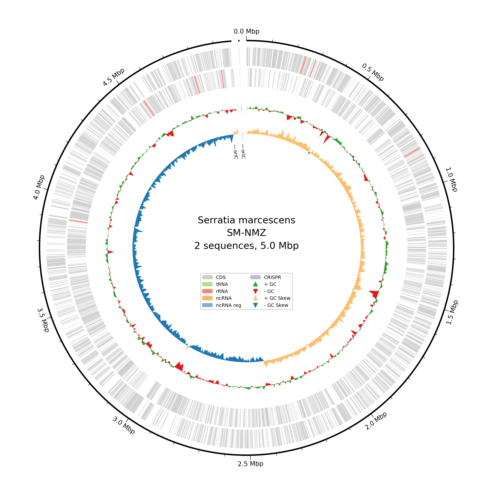
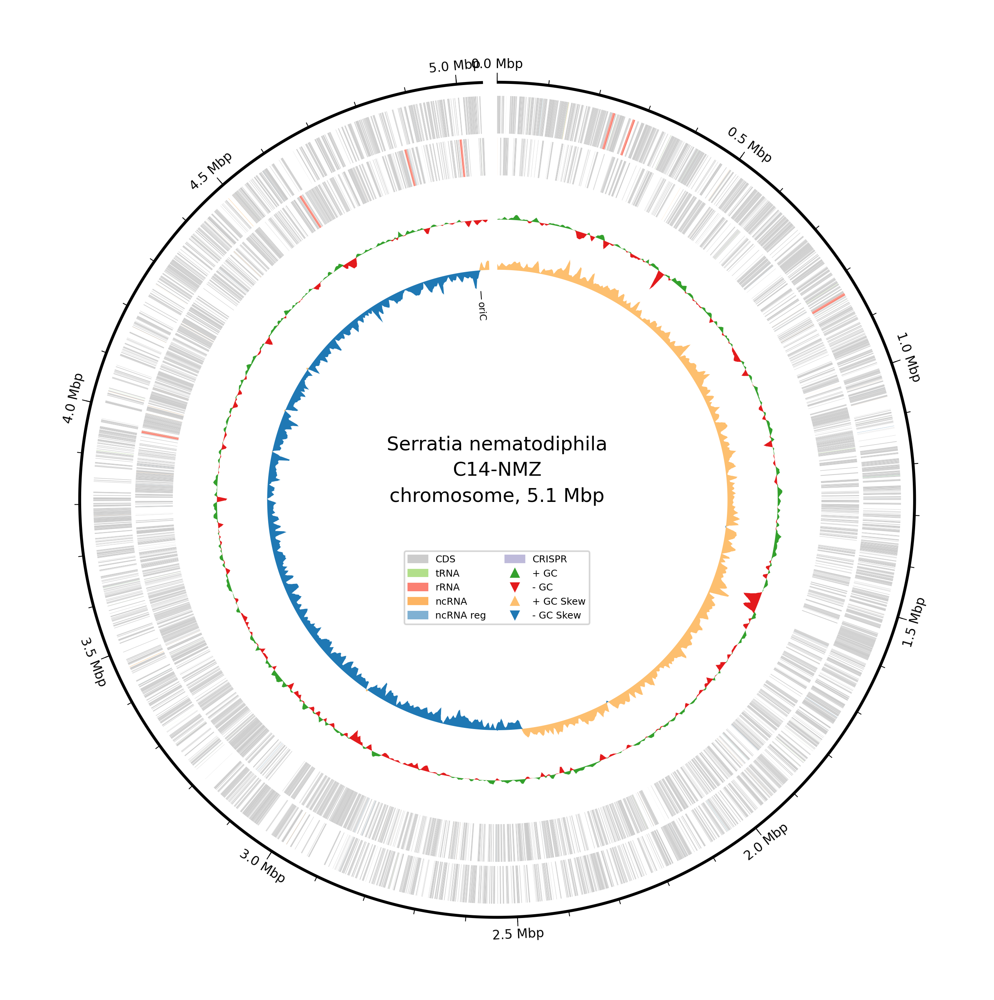
**Figure 1. Circular genomic feature maps of isolates SM-NMZ and C14-NMZ.** Bakta-annotated circular representations of **(A)** SM-NMZ (5.0 Mbp, comprising the circular chromosome and a ~3.58 kb circular plasmid) and **(B)** C14-NMZ (5.1 Mbp circular chromosome). Concentric rings from outside to inside display: (1) Genomic coordinate markers (Mbp) with `oriC` origin of replication; (2) Forward-strand coding sequences (CDS, gray); (3) Reverse-strand CDS (gray), with highlighted structural and non-coding RNA features including tRNA (light green), rRNA (coral), ncRNA (orange), regulatory ncRNA (blue), and CRISPR arrays (purple); (4) GC content plot (+ deviation in green, − in red); and (5) GC skew plot (+ skew in light orange, − skew in blue).

Table 1. Comparative genomic and proteomic annotation features of isolates SM-NMZ and C14-NMZ.

| Genomic / Annotation Metric | SM-NMZ | C14-NMZ |
| :--- | :---: | :---: |
| Genome Size (Mbp) | 4.974 | 5.051 |
| Total Gene / Feature Count | 4,794 | 4,850 |
| G + C Content (%) | 59.8 | 59.8 |
| Coding Sequences (CDS) | 4,566 | 4,626 |
| rRNA Genes | 22 | 22 |
| tRNA / tmRNA Genes | 91 + 1 (92) | 91 + 1 (92) |
| Genes Assigned to UniRef | 4,542 | 4,613 |
| Genes Assigned to RefSeq | 3,682 | 4,205 |
| Genes Assigned to COGs | 3,456 | 3,496 |
| Genes Assigned to KEGG / KO | 1,470 | 1,513 |
| Hypothetical Proteins (No Function Prediction) | 127 | 100 |
| Pseudogenes | 9 | 5 |
| Regulatory ncRNAs (Bakta `ncRNA-region`) | 60 | 56 |
| Additional Replicon (Plasmid) | 1 circular plasmid (~3,581 bp) | None (0) |

*Table 1 note.* Values are derived from the paired Bakta v1.12.0 summary and TSV outputs. Total feature count includes all Bakta feature rows; UniRef, RefSeq, COG, and KEGG/KO values count CDS rows carrying the corresponding database cross-reference; tRNA and tmRNA values are shown separately and as a combined total; and regulatory ncRNAs correspond to Bakta `ncRNA-region` features.

### 2. Taxonomic Identity and Whole-Genome Comparisons

To resolve the precise taxonomic affiliations and evolutionary boundaries of isolates SM-NMZ and C14-NMZ, whole-genome sequences were subjected to digital DNA–DNA hybridization (dDDH) using the Type (Strain) Genome Server (TYGS) alongside average nucleotide identity (ANI) profiling via the Genome Taxonomy Database Toolkit (GTDB-Tk v2). Whole-genome distance phylograms constructed via GBDP and FastME placed both isolates within well-supported monophyletic lineages of the genus *Serratia* (**Figure 2A, B**).

For isolate SM-NMZ, TYGS pairwise comparison against the type strain database yielded a recommended dDDH ($d_4$ formula, independent of genome length) of 95.7% (confidence interval [C.I.] 94.2–96.8%; $d_0 = 96.3\%$, $d_6 = 97.6\%$) with *Serratia marcescens* subsp. *sakuensis* KCTC 42172 and 90.7% (C.I. 88.4–92.5%; $d_0 = 93.8\%$, $d_6 = 95.4\%$) with *Serratia marcescens* ATCC 13880^T^, accompanied by minimal G + C differences of 0.18% and 0.01%, respectively (**Figure 2A**). These values significantly exceed the established 70.0% species and 79.0% subspecies demarcation thresholds, assigning SM-NMZ unambiguously to *Serratia marcescens* within the *S. marcescens* species/subspecies cluster. Concordantly, GTDB-Tk ANI screening confirmed species-level assignment to *Serratia marcescens* with 98.86% ANI (alignment fraction [AF] = 0.947) against reference genome GCF_017299535.1, well above the 95.0% taxonomic circumscription threshold.

For isolate C14-NMZ, TYGS analysis revealed highest genome-wide relatedness to *Serratia nematodiphila* DSM 21420^T^, exhibiting a $d_4$ dDDH value of 85.5% (C.I. 82.8–87.8%; $d_0 = 91.1\%$, $d_6 = 92.7\%$) and a G + C difference of 0.29% (**Figure 2B**). In contrast, dDDH values against *S. marcescens* subsp. *sakuensis* KCTC 42172 (73.9%) and *S. marcescens* ATCC 13880^T^ (73.7%) placed C14-NMZ in the broader *Serratia* species group while distinguishing its sub-lineage. GTDB-Tk screening firmly corroborated this identity, classifying C14-NMZ as *Serratia nematodiphila* with 98.22% ANI (AF = 0.932) against reference GCF_000738675.1. In both isolates, species-level classifications were conclusively resolved at the ANI screening stage without requiring placement-dependent rank metrics (such as Relative Evolutionary Divergence, RED). Together, these whole-genome phylogenomic calculations provide robust taxonomic placement, confirming SM-NMZ as *Serratia marcescens* and C14-NMZ as *Serratia nematodiphila*.

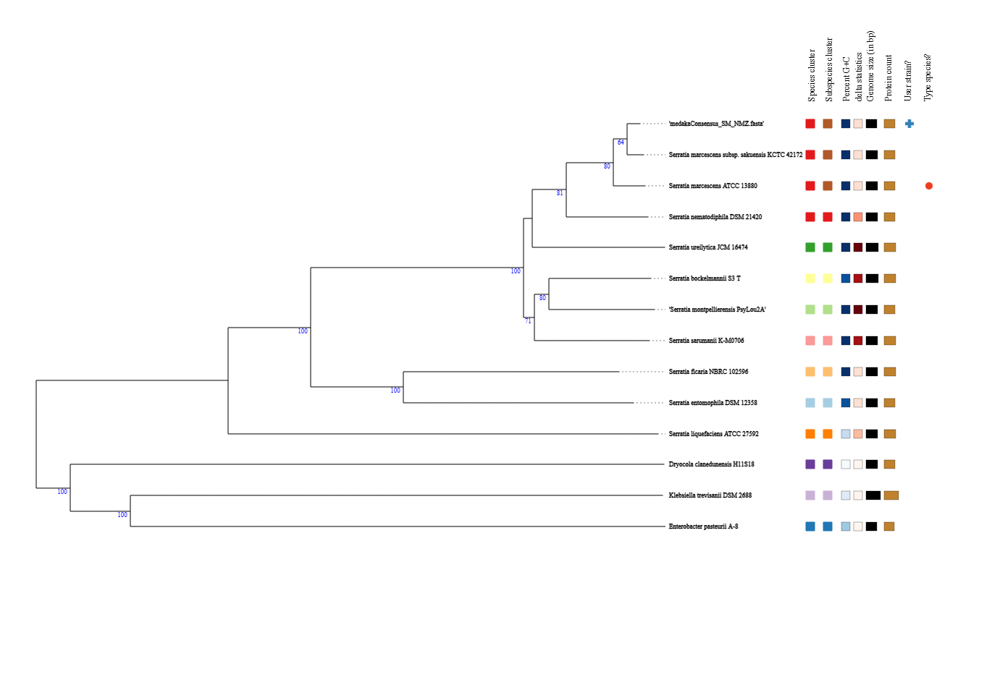
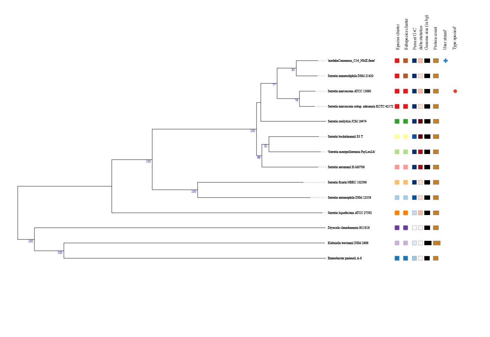
**Figure 2. Whole-genome comparative phylograms for isolates SM-NMZ and C14-NMZ.** Phylograms auto-constructed by the Type (Strain) Genome Server (TYGS) using the Genome BLAST Distance Phylogeny (GBDP) approach and FastME, with branch support based on 100 pseudo-bootstrap replicates, show **(A)** SM-NMZ within the *Serratia marcescens* species/subspecies cluster alongside type strain ATCC 13880^T^ and subsp. *sakuensis* KCTC 42172 and **(B)** C14-NMZ within the *Serratia nematodiphila* lineage near type strain DSM 21420^T^. Right-hand columns denote species/subspecies cluster groupings, % G+C delta statistics, genome size, protein count, and user strain designation (+).

### 3. Secondary Metabolite Biosynthetic Gene Clusters, Metabolic Profiles, and Comparative Virulence-Factor Profile

Genome mining using antiSMASH 7.0 revealed an extensive and versatile secondary metabolome in both SM-NMZ and C14-NMZ, cataloging 11 distinct biosynthetic gene clusters (BGCs) per chromosome (**Figure 3A, B**). The predicted secondary metabolome is dominated by non-ribosomal peptide synthetases (NRPS), which account for multiple specialized loci in each genome. Key conserved clusters common to both isolates include: (i) an NRP-metallophore cluster dedicated to iron scavenging (enterobactin-like catecholate siderophore system, Region 1); (ii) the 14-gene *pig* cluster directing the biosynthesis of the bioactive tripyrrole pigment prodigiosin (Region 5; 1.047–1.082 Mbp in SM-NMZ and 1.057–1.092 Mbp in C14-NMZ); (iii) a conserved *swrW*-anchored NRPS locus directing the synthesis of cyclic lipopeptide biosurfactants (serrawettin W1, Region 11); (iv) a beta-lactone BGC (Region 3 in SM-NMZ, Region 2 in C14-NMZ); (v) a terpene precursor BGC (Region 4); (vi) an azole-containing ribosomally synthesized and post-translationally modified peptide (RiPP) locus (Region 6); and (vii) a redox-cofactor associated cluster (Region 8). Strain-specific diversification is evident in C14-NMZ, which uniquely harbors a ranthipeptide (radical SAM-dependent RiPP) cluster (Region 3) and an opine-like metallophore BGC (Region 7), reflecting specialized secondary metabolic adaptations tailored to its savanna rhizosphere habitat.

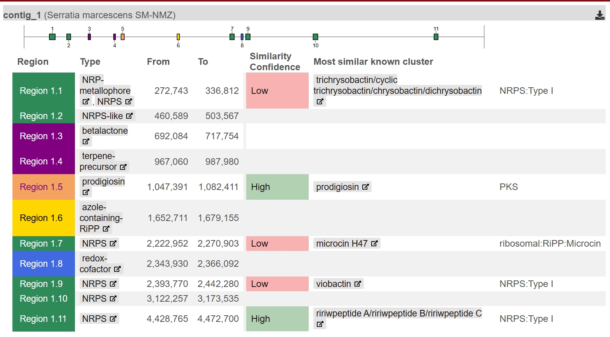
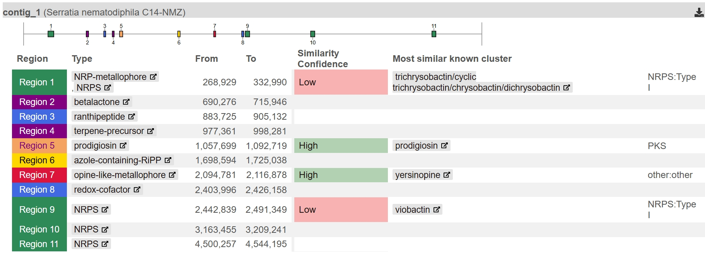
**Figure 3. Genome-wide secondary metabolite biosynthetic gene cluster (BGC) architecture.** antiSMASH 7.0 overview maps of identified secondary metabolite biosynthetic regions mapped along the circular chromosomes of **(A)** SM-NMZ (11 BGC regions) and **(B)** C14-NMZ (11 BGC regions). Predicted clusters encompass non-ribosomal peptide synthetases (NRPS and NRP-metallophores, including enterobactin-like siderophores and serrawettin W1), pyrrole/pigment pathways (prodigiosin), terpenes, beta-lactones, ribosomally synthesized and post-translationally modified peptides (azole-containing RiPPs and ranthipeptides), redox-cofactors, and specialized metallophores. Color-coded functional bars denote core biosynthetic genes, additional biosynthetic genes, transport-related machinery, and regulatory elements across each genomic locus.

Metabolic pathway distillation via DRAM across the 14-genome dataset demonstrated a highly conserved, robust metabolic core among the 13 *Serratia* genomes, with the Pectobacteriaceae representative *Prodigiosinella aquatilis* PA-LS101 resolving as a clear metabolic outgroup (**Figure 4A, B**). Central carbon metabolism across SM-NMZ, C14-NMZ, and congeneric isolates exhibits complete pathways for glycolysis (Embden-Meyerhof-Parnas), the Entner-Doudoroff pathway, the pentose phosphate shunt, and the complete citrate/TCA cycle (**Figure 4A**). The respiratory electron transport chain reflects metabolic plasticity under variable redox conditions: both isolates encode complete Complex I (NADH dehydrogenase), Complex II (succinate dehydrogenase), and Complex V (F/V-type ATP synthases), paired with both low-affinity ($aa_3/o$-type) and high-affinity ($bd$- and $cbb_3$-type) terminal cytochrome oxidases that enable efficient respiration across oxygen gradients. Auxiliary functional profiling revealed intact CAZy suites for starch and pectin degradation, assimilatory and dissimilatory nitrate-to-nitrite reduction, and specialized arsenate reductases (**Figure 4B**).

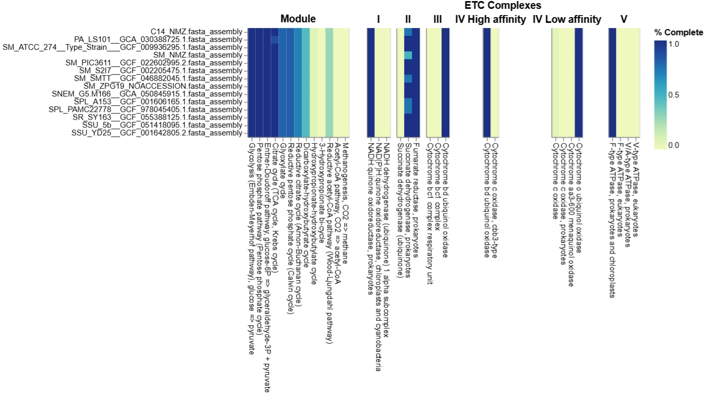
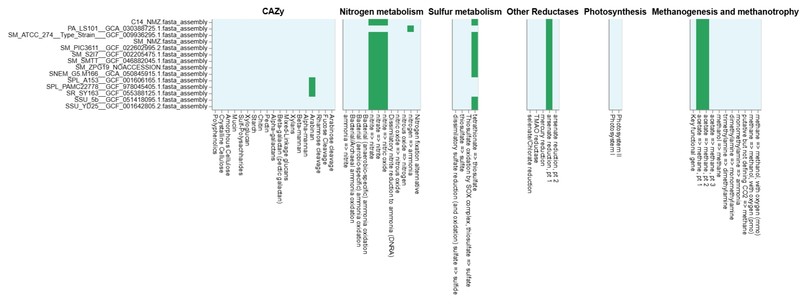
**Figure 4. Distillation of central and specialized microbial metabolism across comparative *Serratia* genomes (DRAM).** Functional pathway distillation heatmaps generated by DRAM across 13 *Serratia* genomes and the *Prodigiosinella aquatilis* PA-LS101 outgroup. Color bar indicates percentage module completeness ranging from 0.0 (pale yellow) to 1.0 (dark blue). **(A)** Central carbon metabolism and respiratory electron transport chain (ETC) complexes, including Glycolysis, Entner-Doudoroff, Pentose Phosphate, Citrate/TCA cycle, Glyoxylate shunt, Reductive Acetyl-CoA pathways, and Complexes I–V (NADH dehydrogenase, Succinate dehydrogenase, Cytochrome bc1, Cytochrome bd/cbb3/aa3 oxidases, and F/V-type ATP synthases). **(B)** Specialized functional categories covering Carbohydrate-Active enZymes (CAZy; cellulose, starch, pectin, arabinan degradation), Nitrogen metabolism (nitrate to nitrite reduction), Sulfur metabolism (tetrathionate reduction), Other Reductases (arsenate reduction), Photosynthesis (negative controls), and Methanogenesis/methanotrophy pathways.

Comparative profiling of virulence-associated factors against the Virulence Factor Database (VFDB) using `VF_classifier` contextualized the genomic repertoire of SM-NMZ and C14-NMZ relative to 12 environmental and hydrocarbon-associated *Serratia* strains (**Figure S1**). Virulence-associated homologs detected across the isolates primarily correspond to conserved physiological machinery supporting environmental fitness, cellular motility, and nutrient acquisition. These include complete flagellar assembly and chemotaxis operons (motility), Type VI Secretion Systems (T6SS-I, II, and III effector delivery complexes involved in interbacterial competition), and high-affinity iron capture systems (HasA hemophores, enterobactin, and ferric uptake regulators). While hemolysin-like homologs (*shlA*–*shlB*) were identified, their distribution mirrors that of harmless environmental saprophytes and bioremediation strains, highlighting that these genomic features function primarily as competitive adaptations for environmental persistence, niche colonization, and nutrient mobilization rather than clinical virulence determinants.

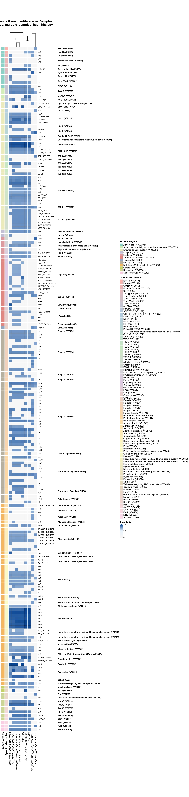
**Figure S1. Comparative virulence-factor landscape of *Serratia* isolates (VFDB / VF_classifier).** Hierarchically clustered sequence-identity heatmap (0–100%, light to dark blue) of virulence factors identified via `VF_classifier` against the Virulence Factor Database (VFDB) across SM-NMZ, C14-NMZ, and 12 environmental/bioremediation comparative *Serratia* and outgroup strains. Genes are grouped by Broad Categories (Adherence, Effector delivery systems, Enzymes, Exotoxins, Immune evasion, Motility, Iron acquisition, and Secretion systems) and Specific Functional Mechanisms (T6SS-I/II/III clusters, flagellar apparatus, hemolysins ShlA–ShlB, HasA hemophore systems, enterobactin, and aerobactin). The profile contextualizes conserved or divergent homologs associated with environmental persistence, motility, and iron acquisition; it does not by itself establish biosafety or exclude pathogenicity islands. (*Designated as Supplementary Figure S1 due to vertical dimension*).

### 4. Hydrocarbonoclastic Potential and Biosurfactant / Pour Point Depressant (PPD)-Associated Genomic Potential
Mapping of hydrocarbon degradation marker genes (HADEG) and syntenic conservation of candidate biosurfactant/bio-emulsifier loci (serrawettin, prodigiosin) as genomic evidence relevant to PPD, alkane-mobilization, and surface-tension-reduction hypotheses; these figures are not direct measurements of PPD activity.

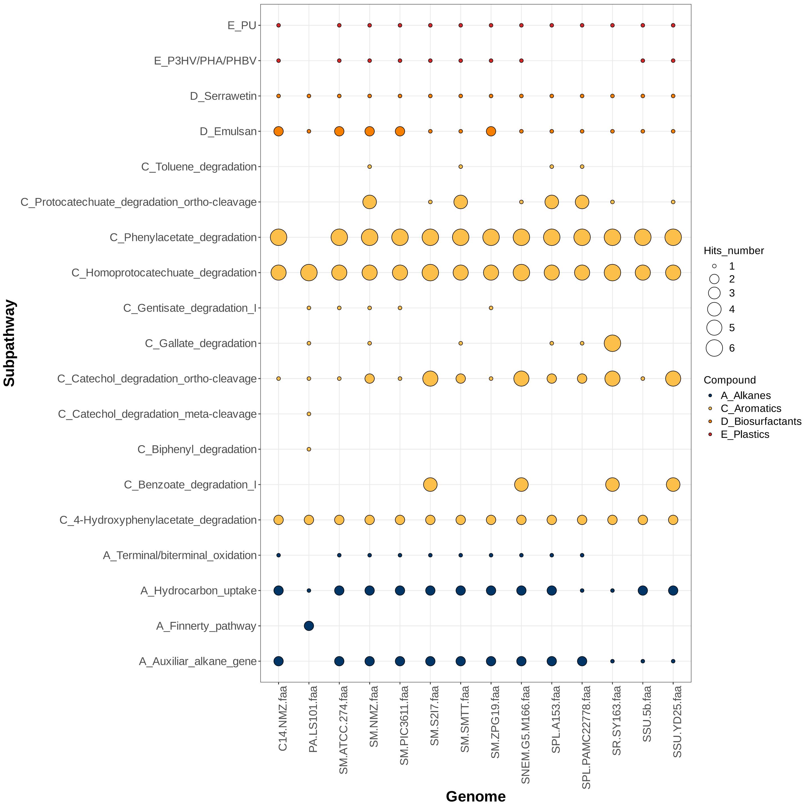
**Figure 5. Genomic repertoire of hydrocarbon-degradation and biosurfactant marker genes (HADEG).** Bubble plot illustrating the distribution and hit counts of curated aerobic hydrocarbon-degradation marker genes across the 14-genome dataset, representing genomic potential rather than demonstrated pathway activity. Subpathways on the Y-axis are grouped into four major classes: **A_Alkanes** (dark blue circles: hydrocarbon uptake, alkane terminal/biterminal oxidation, and auxiliary alkane-degradation genes), **C_Aromatics** (yellow circles: phenylacetate, homoprotocatechuate, protocatechuate ortho-cleavage, catechol ortho/meta-cleavage, benzoate, and gentisate degradation), **D_Biosurfactants** (orange circles: serrawettin and emulsan biosynthetic loci), and **E_Plastics** (red circles: PU and PHA/PHBV degradation). Bubble diameters correspond to normalized gene-copy hit numbers (1 to 6).

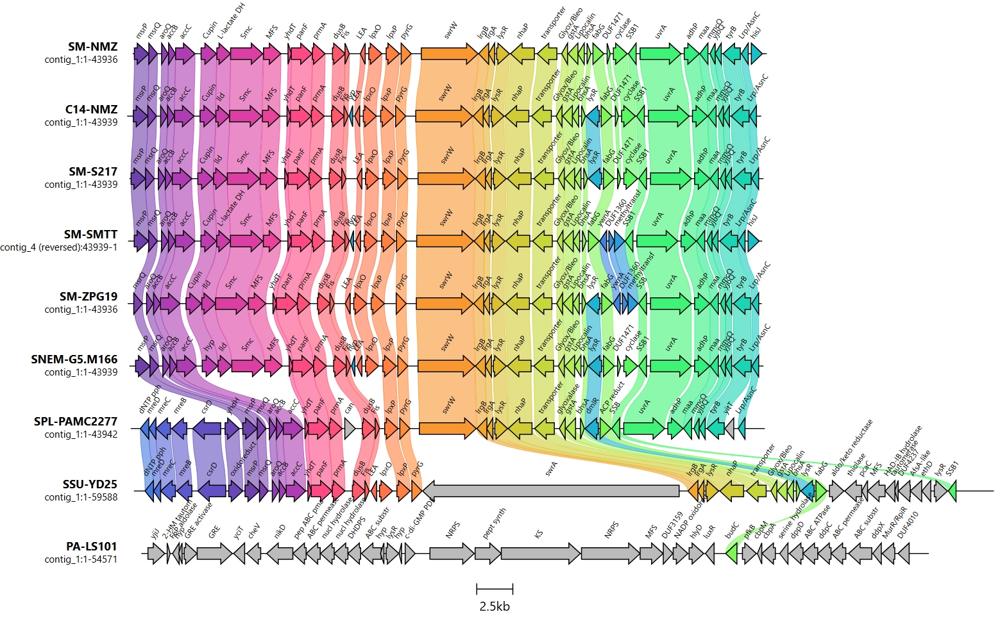
**Figure 6. Genomic synteny and neighborhood architecture of a serrawettin-associated locus.** Comparative gene-cluster alignment constructed with `clinker` (scale bar = 2.5 kb) detailing the serrawettin-associated non-ribosomal peptide synthetase (*swrW*, orange block arrow) across *Serratia* sp. SM-NMZ, *Serratia* sp. C14-NMZ, and 7 comparative genomes. Flanking conserved genomic architecture highlights upstream cell division/metabolism genes (*msrP*, *aroQ*, *lld*, *Smc*, *MFS*, *yhdT*, *panF*, *dusB*, *fis*, *lpxOP*, *pyrG*) and downstream transport/stress-response operons (*IrgBA*, *lysR*, *nhaP*, *gstA*, *lipocalin*, *fabG*, *SSB1*, *uvrA*, *adhP*, *tyrB*). LC-HRMS profiling, which detected serrawettin W1 and serratamolide C, provides experimental confirmation of serrawettin-associated metabolite production under the tested conditions. Connecting colored linkages represent pairwise amino-acid sequence identity.

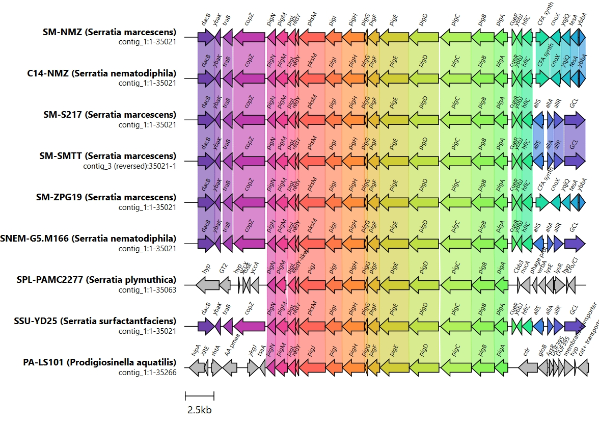
**Figure 7. Syntenic organization of the 14-gene prodigiosin (*pig*) locus.** Gene-cluster comparison map generated using `clinker` (scale bar = 2.5 kb) illustrating the *pigA*–*pigN* arrangement associated with prodigiosin biosynthesis across SM-NMZ, C14-NMZ, and reference *Serratia* genomes. Arrows represent open reading frames with direction of transcription: *pigA*–*pigE* (proline incorporation and MAP condensation, light green), *pigF*–*pigH* (MBC biosynthesis, orange), *pigI*–*pigN* (condensing and tailoring enzymes, pink/red). Flanking boundaries show conserved upstream (*dacB*, *ybak*, *traB*, *copZ*) and downstream (*cueR*, *ybbJ*, *hflC*, *cfa*, *allSAR*) loci. The red/pink-pigmented culture phenotype provides experimental confirmation of the prodigiosin-associated metabolite phenotype under the tested conditions alongside the conserved *pig* arrangement.

### 5. LadA Flavin-Dependent Monooxygenase Phylogeny and Comparative Pan-Proteome Orthology
Maximum-likelihood phylogenetic placement of LadA-like monooxygenase candidates ($ladA\alpha$, $ladA\beta$, $ladB$) and clinker neighborhood synteny of ladA loci, followed by ProteinOrtho pan-proteome orthology evaluation across the 14 comparative genomes.

**Figure 8. Maximum-likelihood phylogram placing candidate LadA-family flavin-dependent monooxygenases.** Radial unrooted phylogenetic tree inferred with IQ-TREE 3 under the `Q.PFAM+R3` substitution model (determined by ModelFinder via BIC) based on MAFFT (L-INS-i) alignment and ClipKIT trimming. Candidate monooxygenases identified in *Serratia* sp. SM-NMZ (`NNLMDO_015255`) and *Serratia* sp. C14-NMZ (`OJMJKD_015520`) fall within a LadA-associated sequence clade alongside canonical long-chain alkane monooxygenase LadA from *Geobacillus thermodenitrificans* NG80-2 (`A4IU28`) and LadA alpha from *Geobacillus thermoleovorans* B23 (`BAM76377.1`), distinct from reference clades comprising DszA dibenzothiophene monooxygenases (`P54995`, `Q0ZIH7`), NtaA nitrilotriacetate monooxygenases (`P54989`), SsuD alkanesulfonate monooxygenases (`P80645`, `A4W8V4`), and bacterial luciferases.

> **Interpretive note:** Report the relevant UFBoot branch-support values for the candidate/reference nodes in the Results text. Phylogenetic placement is sequence-level evidence and does not establish biochemical activity, substrate specificity, or alkane turnover.

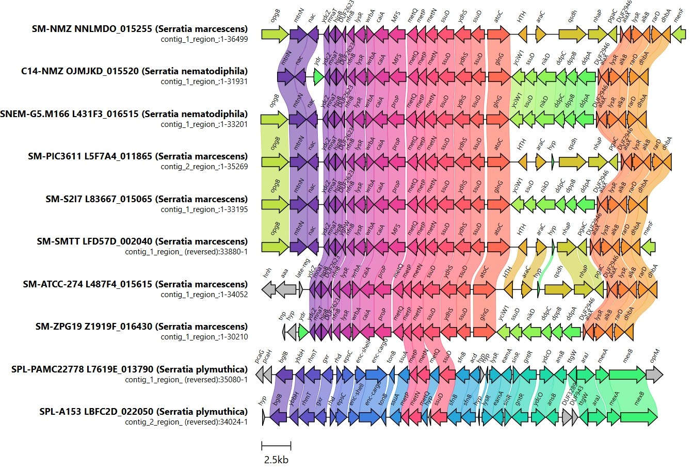
**Figure 9. Micro-synteny and genomic neighborhood of a candidate *ladA*-associated locus.** Curated genomic synteny alignment (`clinker`, scale bar = 2.5 kb) surrounding the *ladA*-associated locus across 10 *Serratia* genomes. Highlights the flavin-dependent monooxygenase-like core gene pair (*ssuD* / *ladA* homolog and *ydhS*, pink arrows) in SM-NMZ (`NNLMDO_015255`) and C14-NMZ (`OJMJKD_015520`), accompanied by upstream sulfur/methionine uptake transport systems (*metQPN*, *prop*, *MFS*, *wrbA*, *nfnB*, *nac*, *mtnN*) and downstream regulatory/alkane-adaptation genes (*atoC*, *glnG*, *nikD*, *ddpABCD*, *nhaP*, *alkB*, *rarD*, *dhbA*). Syntenic linkage bands indicate pairwise amino acid sequence identity; locus conservation does not establish biochemical activity or substrate turnover.

## References

1. Benoit, G., Raguideau, S., James, R., Phillippot, L., Urich, T., Quince, C., & Koszul, R. (2024). High-quality metagenome assembly from long accurate reads with metaMDBG. *Nature Biotechnology*, 42, 1378–1383. https://doi.org/10.1038/s41587-023-01983-6
2. Blin, K., Shaw, S., Augustijn, H. E., Reitz, Z. L., Biermann, F., Alanjary, M., ... & Weber, T. (2023). antiSMASH 7.0: new and improved predictions for detection, regulation, chemical structures, and visualisation. *Nucleic Acids Research*, 51(W1), W46–W50. https://doi.org/10.1093/nar/gkad344
3. Boonmak, C., Takahashi, Y., & Morikawa, M. (2014). Cloning and expression of three ladA-type alkane monooxygenase genes from an extremely thermophilic alkane-degrading bacterium *Geobacillus thermoleovorans* B23. *Extremophiles*, 18(3), 515–523. https://doi.org/10.1007/s00792-014-0636-y
4. Bouras, G., Grigson, S. R., Papudeshi, B., Mallawaarachchi, V., & Roach, M. J. (2024). dnaapler: A tool to reorient circular microbial genomes. *Journal of Open Source Software*, 9(93), 5968. https://doi.org/10.21105/joss.05968
5. Buchfink, B., Reuter, K., & Drost, H. G. (2021). Sensitive protein alignments at tree-of-life scale using DIAMOND. *Nature Methods*, 18(4), 366–368. https://doi.org/10.1038/s41592-021-01101-x
6. Camacho, C., Coulouris, G., Avagyan, V., Ma, N., Papadopoulos, J., Bealer, K., & Madden, T. L. (2009). BLAST+: architecture and applications. *BMC Bioinformatics*, 10, 421. https://doi.org/10.1186/1471-2105-10-421
7. Chaumeil, P.-A., Mussig, A. J., Hugenholtz, P., & Parks, D. H. (2022). GTDB-Tk v2: memory friendly classification with the Genome Taxonomy Database. *Bioinformatics*, 38(23), 5315–5316. https://doi.org/10.1093/bioinformatics/btac672
8. Cheng, H., Concepcion, G. T., Feng, X., Zhang, H., & Li, H. (2021). Haplotype-resolved de novo assembly using phased assembly graphs with hifiasm. *Nature Methods*, 18(2), 170–175. https://doi.org/10.1038/s41592-020-01056-5
9. De Coster, W., & Rademakers, R. (2023). NanoPack2: population-scale evaluation of long-read sequencing data. *Bioinformatics*, 39(5), btad311. https://doi.org/10.1093/bioinformatics/btad311
10. De Coster, W., D'Hert, S., Schultz, D. T., Cruts, M., & Van Broeckhoven, C. (2018). NanoPack: visualizing and processing long-read sequencing data. *Bioinformatics*, 34(15), 2666–2669. https://doi.org/10.1093/bioinformatics/bty149
11. Feng, L., Wang, W., Cheng, J., Ren, Y., Zhao, G., Gao, C., ... & Wang, L. (2007). Genome and proteome of long-chain alkane degrading *Geobacillus thermodenitrificans* NG80-2. *Proceedings of the National Academy of Sciences*, 104(14), 5602–5607. https://doi.org/10.1073/pnas.0611550104
12. Gilchrist, C. L. M., & Chooi, Y. H. (2021). clinker & clustermap.js: automatic generation of gene cluster comparison figures. *Bioinformatics*, 37(16), 2473–2475. https://doi.org/10.1093/bioinformatics/btab007
13. Gittins, D. A., Harmon, L. J., & Agrawal, A. (2022). CANT-HYD: A curated database of phylogeny-derived hidden Markov models for annotation of marker genes involved in hydrocarbon degradation. *Frontiers in Microbiology*, 13, 764058. https://doi.org/10.3389/fmicb.2021.764058
14. Hoang, D. T., Chernomor, O., von Haeseler, A., Minh, B. Q., & Vinh, L. S. (2018). UFBoot2: improving the ultrafast bootstrap approximation. *Molecular Biology and Evolution*, 35(2), 518–522. https://doi.org/10.1093/molbev/msx281
15. Kalyaanamoorthy, S., Minh, B. Q., Wong, T. K. F., von Haeseler, A., & Jermiin, L. S. (2017). ModelFinder: fast model selection for accurate phylogenetic estimates. *Nature Methods*, 14(6), 587–589. https://doi.org/10.1038/nmeth.4285
16. Katoh, K., & Standley, D. M. (2013). MAFFT multiple sequence alignment software version 7: improvements in performance and usability. *Molecular Biology and Evolution*, 30(4), 772–780. https://doi.org/10.1093/molbev/mst010
17. Kolmogorov, M., Yuan, J., Lin, Y., & Pevzner, P. A. (2019). Assembly of long, error-prone reads using repeat graphs. *Nature Biotechnology*, 37(5), 540–546. https://doi.org/10.1038/s41587-019-0072-8
18. Koren, S., Walenz, B. P., Berlin, K., Miller, J. R., Bergman, N. H., & Phillippy, A. M. (2017). Canu: scalable and accurate long-read assembly via adaptive k-mer weighting and repeat separation. *Genome Research*, 27(5), 722–736. https://doi.org/10.1101/gr.215087.116
19. Lechner, M., Findeiß, S., Steiner, L., Marz, M., Stadler, P. F., & Prohaska, S. J. (2011). Proteinortho: detection of (co-)orthologs in large-scale analysis. *BMC Bioinformatics*, 12, 124. https://doi.org/10.1186/1471-2105-12-124
20. Letunic, I., & Bork, P. (2021). Interactive Tree Of Life (iTOL) v5: an online tool for phylogenetic tree display and annotation. *Nucleic Acids Research*, 49(W1), W293–W296. https://doi.org/10.1093/nar/gkab301
21. Liu, B., Zheng, D., Zhou, S., Chen, L., & Yang, J. (2022). VFDB 2022: a general classification scheme for bacterial virulence factors. *Nucleic Acids Research*, 50(D1), D912–D917. https://doi.org/10.1093/nar/gkab1107
22. Meier-Kolthoff, J. P., & Göker, M. (2019). TYGS is an automated high-throughput platform for state-of-the-art genome-based taxonomy. *Nature Communications*, 10(1), 2182. https://doi.org/10.1038/s41467-019-10210-3
23. Oxford Nanopore Technologies. Dorado [Software]. https://github.com/nanoporetech/dorado
24. Parks, D. H., Chuvochina, M., Rinke, C., Mussig, A. J., Chaumeil, P.-A., & Hugenholtz, P. (2022). GTDB: an ongoing census of bacterial and archaeal diversity through a phylogenetically consistent, rank normalized and complete genome-based taxonomy. *Nucleic Acids Research*, 50(D1), D785–D794. https://doi.org/10.1093/nar/gkab776
25. Parte, A. C., Sardà Carbasse, J., Meier-Kolthoff, J. P., Reimer, L. C., & Göker, M. (2020). List of Prokaryotic names with Standing in Nomenclature (LPSN) moves to the DSMZ. *International Journal of Systematic and Evolutionary Microbiology*, 70(11), 5607–5612. https://doi.org/10.1099/ijsem.0.004332
26. Rojas-Vargas, J. A., Castelán-Sánchez, H. G., & Pardo-López, L. (2023). HADEG: a curated hydrocarbon aerobic degradation enzymes and genes database. *Computational Biology and Chemistry*, 107, 107966. https://doi.org/10.1016/j.compbiolchem.2023.107966
27. Schwengers, O., Jelonek, L., Dieckmann, M. A., Beyvers, S., Blom, J., & Goesmann, A. (2021). Bakta: rapid and standardized annotation of bacterial genomes via a comprehensive and consistent annotation framework. *Microbial Genomics*, 7(11), 000685. https://doi.org/10.1099/mgen.0.000685
28. Shaffer, M., Borton, M. A., McGivern, B. B., Zayed, A. A., La Rosa, S. L., ... & Wrighton, K. C. (2020). DRAM for distilling microbial metabolism to automate the curation of microbiome function. *Nucleic Acids Research*, 48(16), 8883–8900. https://doi.org/10.1093/nar/gkaa621
29. Shaw, J., Marin, M. G., & Li, H. (2026). High-resolution metagenome assembly for modern long reads with myloasm. *Nature Biotechnology*. https://doi.org/10.1038/s41587-026-03053-z
30. Steenwyk, J. L., Buida, T. J., III, Li, Y., Shen, X.-X., & Rokas, A. (2020). ClipKIT: a multiple sequence alignment trimming software for accurate phylogenomic inference. *PLOS Biology*, 18(12), e3001007. https://doi.org/10.1371/journal.pbio.3001007
31. Vaser, R., & Šikić, M. (2021). Time- and memory-efficient genome assembly with Raven. *Nature Computational Science*, 1, 332–336. https://doi.org/10.1038/s43588-021-00073-4
32. Wick, R. R. Filtlong: quality filtering tool for long reads [Software]. https://github.com/rrwick/Filtlong
33. Wick, R. R., Howden, B. P., & Stinear, T. P. (2025). Autocycler: long-read consensus assembly for bacterial genomes. *Bioinformatics*, 41(9), btaf474. https://doi.org/10.1093/bioinformatics/btaf474
34. Wick, R. R., Judd, L. M., & Holt, K. E. (2023). Assembling the perfect bacterial genome using Oxford Nanopore and Illumina sequencing. *Bioinformatics*, 39(7), btad382. https://doi.org/10.1093/bioinformatics/btad382
35. Wong, T. K. F., Ly-Trong, N., Ren, H., Demotte, P., Banos, H., Roger, A. J., Susko, E., Bielow, C., De Maio, N., Goldman, N., Hahn, M. W., dos Reis, M., Vinh, L. S., Huttley, G., Lanfear, R., & Minh, B. Q. (2026). IQ-TREE 3: Phylogenomic inference software using complex evolutionary models. *Molecular Biology and Evolution*, msag117. https://doi.org/10.1093/molbev/msag117
