# Manuscript
## Materials & Methods
### A. Whole Genome Sequencing
Both isolates were subcultured by streaking onto fresh NA plates until single colonies appeared. A single colony was then transferred into Nutrient Broth and incubated for ~16–24 hours. Cells were harvested by centrifugation, and genomic DNA (gDNA) was extracted using the GeneAid Presto Mini gDNA Bacteria Kit. The purity and concentration of the extracted gDNA were assessed with an Implen NP80 NanoPhotometer. Approximately 200 ng of DNA was used for library preparation with the Rapid Barcoding Kit 24 V14 (SQK‑RBK114.24), followed by loading onto a PromethION flow cell (Oxford Nanopore Technologies, ONT). Sequencing was performed using MinKNOW software for ~28 hours with the dna_r10.4.1_e8.2_400bps_sup@v5.0.0 basecalling model, with adapters and barcodes automatically detected and trimmed. The resulting raw fastq.gz files were stored and concatenated into a single fastq.gz file on the PromethION DAU computer.
### B. De Novo Assembly and Genome Annotation
Raw reads (fastq.gz) were quality‑assessed using NanoPlot [11] (NanoPlot ‑t 24 ‑c green --fastq merged‑fastq.gz ‑o NanoPlot‑isolateID --loglength --plots dot --N50). Reads were first filtered with Chopper [10] (pigz ‑dc merged‑fastq.gz | chopper ‑q 10 ‑l 500 | pigz > filtered‑reads.fastq.gz), then further refined using Filtlong [50] (filtlong --keep_percent 90 filtered‑reads.fastq.gz | pigz > filt‑reads.fastq.gz). Filtered reads were iteratively assembled with Autocycler [51] through Flye [23], Canu [24], Hifiasm [9], Raven [48], Plassembler [5], Myloasm [44], and metaMDBG [1] on seven subsampled datasets. Draft assemblies were reoriented with dnaapler [4] (dnaapler all ‑i draft‑assembly.fasta ‑o dnaapler‑reoriented ‑p isolateID ‑t 16) and polished using Dorado polish [34]. Annotation was performed with Bakta [41], complemented by CANT‑HYD.hmm [22] to target hydrocarbon‑related genes (https://github.com/dgittins/CANT-HYD-HydrocarbonBiodegradation), set using the --hmms flag.
### C. Taxonomic Identity, Biosynthetic Gene Cluster Analysis, and Complementary Genomic Characterization
The final Dorado-polished assemblies, including both SM-NMZ replicons, were analyzed together using the Type (Strain) Genome Server (TYGS, https://tygs.dsmz.de/) [30], with results provided on 18 October 2026. Genome BLAST Distance Phylogeny (GBDP) used the trimming algorithm and distance formula d5; FastME v2.1.6.1 inferred a midpoint-rooted tree with 100 pseudo-bootstrap replicates. Digital DNA–DNA hybridization (dDDH) values and confidence intervals were calculated with GGDC 4.0, reporting the recommended d4 formula. TYGS species and subspecies clustering used 70% and 79% dDDH thresholds, respectively. GTDB-Tk v2.7.2 `classify_wf` against GTDB r232 [8] supplied complementary average nucleotide identity (ANI) screening. These results were used as complementary evidence for isolate identity; because this run did not require pplacer placement, placement-dependent rank metrics were not reported. Nomenclature, synonymy, and associated taxonomic literature were checked against TYGS's sister database, the List of Prokaryotic names with Standing in Nomenclature (LPSN) [36], and the Genome Taxonomy Database (GTDB) [35] (available at https://lpsn.dsmz.de/ and https://gtdb.ecogenomic.org/). For analyzing biosynthetic gene clusters (BGCs) of potential secondary metabolites, antiSMASH [2] was employed, along with additional complementary annotations from DRAM [42] to assess the metabolic capabilities of the isolates. The VF_classifier pipeline [28] was then used to identify and classify virulence factors. Comparative analyses were performed using several published Serratia spp. genomes curated from NCBI Genome Datasets, with custom scripts and pipelines documented in the following GitHub repositories: https://github.com/WhyAdr/ProkaryONT and https://github.com/WhyAdr/Serratia_genomes.
### D. Profiling of Hydrocarbonoclastic and Biosurfactant Production Potential
Annotated proteome files (.faa) generated by Bakta were further processed using the HADEG pipeline [39] (https://github.com/jarojasva/HADEG) to evaluate hydrocarbon degradation pathways and biosurfactant biosynthetic gene potential. The presence, genomic organization, and synteny of hydrocarbonoclastic and biosurfactant biosynthesis-related genes were analyzed using custom Biopython-based scripts along with curated marker gene sets (https://github.com/WhyAdr/genbank-parser and https://github.com/WhyAdr/antiSMASH-review).

Selected focal-pair neighborhoods were extracted using genbank-parser and rendered using DNA Features Viewer [54], preserving annotated strand and genomic spacing.

### E. Comparative Proteome Orthology and LadA Flavin-Dependent Monooxygenase Phylogeny
To assess orthologous relationships and syntenic conservation across the comparative dataset (14 proteomes comprising SM-NMZ, C14-NMZ, 11 comparative Serratia spp. genomes, and Prodigiosinella aquatilis PA-LS101 as an outgroup), proteome-wide clustering was performed using ProteinOrtho [25] (v6.3.6) with the DIAMOND [6] (v2.2.5) backend and PoFF synteny mode (-p=diamond -cov=70 -identity=25 -singles). Candidates for long-chain alkane monooxygenases (LadA family) and related LLM-class flavin-dependent monooxygenases were identified by BLASTp [7] searches against reference query sequences: LadA alpha (BAM76377.1), LadA beta (BAM76372.1), and LadB (BAM76371.1) from Geobacillus thermoleovorans strain B23 [3], canonical LadA (A4IU28) from Geobacillus thermodenitrificans strain NG80-2 [13], and a curated comparative panel of 19 functional reference oxidoreductases (e.g., SsuD, DszA, NtaA, and LuxA). Retrieved homologous sequences (E-value <= 1e-5, query coverage >= 50%) were aligned alongside reference queries using MAFFT [21] (v7.526) under the iterative L-INS-i strategy (--localpair --maxiterate 1000). Alignment gaps were filtered using ClipKIT [45] in smart-gap mode (-m smart-gap). Maximum-likelihood phylogenetic trees were reconstructed using IQ-TREE [52] (v3.1.3) with automatic model selection via ModelFinder [20] (best-fit model determined as Q.PFAM+R3 according to BIC) and branch support evaluated with 1,000 ultrafast bootstrap replicates (UFBoot2) [17]. Phylogenetic trees were visualized and edited using iTOL webserver [27], then the parsed local genomic neighborhood synteny was visualized using clinker [15].

## Results & Discussion

### 1. Genomic and Proteomic Feature Characteristics

Genome-resolved characterization of isolates SM-NMZ (recovered from slaughterhouse effluent) and C14-NMZ (obtained from the rhizosphere of *Calotropis gigantea* shrubs in the savanna settings of Baluran National Park) yielded closed circular assemblies for both isolates. The genome of SM-NMZ spans 4,974,098 bp (4.974 Mbp) across two circular replicons—a 4,970,517 bp circular chromosome and an extrachromosomal circular plasmid of 3,581 bp (~3.58 kb)—with an overall G + C content of 59.8%. In contrast, C14-NMZ resolved into a single, contiguous circular chromosome of 5,050,553 bp (5.051 Mbp) with an identical G + C content of 59.8% and no detected plasmid replicon (**Figure 1A, B**; **Table 1**). The circular maps show GC-content and GC-skew patterns with annotated *oriC* locations in both chromosomes (**Figure 1**); these are descriptive assembly features rather than independent measures of assembly accuracy.

Functional annotation using the Bakta pipeline [41] cataloged 4,794 total genomic features for SM-NMZ and 4,850 for C14-NMZ, including 4,566 and 4,626 protein-coding sequences (CDS), corresponding to coding densities of 88.5% and 88.9%, respectively (**Table 1**). Both annotations contained 22 rRNA genes and 92 RNA features relevant to translation and trans-translation (91 tRNAs and one tmRNA per genome). Database cross-references covered 4,542 (99.5%) and 4,613 (99.7%) CDSs in UniRef, 3,682 and 4,205 in NCBI RefSeq, 3,456 and 3,496 in Clusters of Orthologous Groups (COGs), and 1,470 and 1,513 in Kyoto Encyclopedia of Genes and Genomes (KEGG) Orthology (KO) for SM-NMZ and C14-NMZ, respectively (**Table 1**).

Both isolates contained few annotated pseudogenes (9 in SM-NMZ and 5 in C14-NMZ) and a small annotated hypothetical-protein fraction (127 CDSs [2.8%] in SM-NMZ and 100 CDSs [2.2%] in C14-NMZ). These counts describe the annotation output but do not establish functional completeness. Bakta also identified 60 `ncRNA-region` features in SM-NMZ and 56 in C14-NMZ, including riboswitches, leader and untranslated-region elements, thermoregulatory RNAs, and other regulatory/non-coding features. Together with the small plasmid unique to SM-NMZ, these measurements define the annotated genomic inventory and the principal replicon difference between the isolates; functional capacity and environmental phenotypes require targeted analyses or experiments.

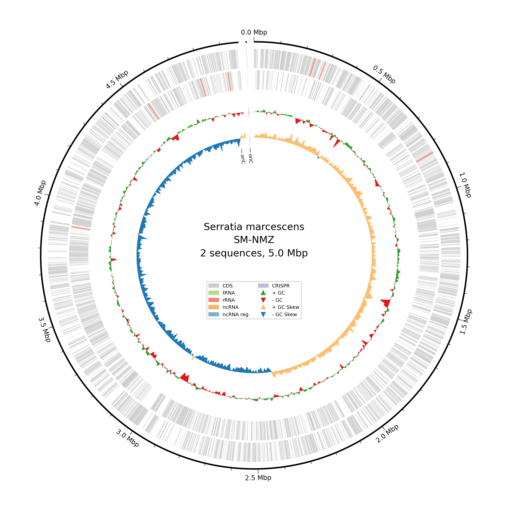
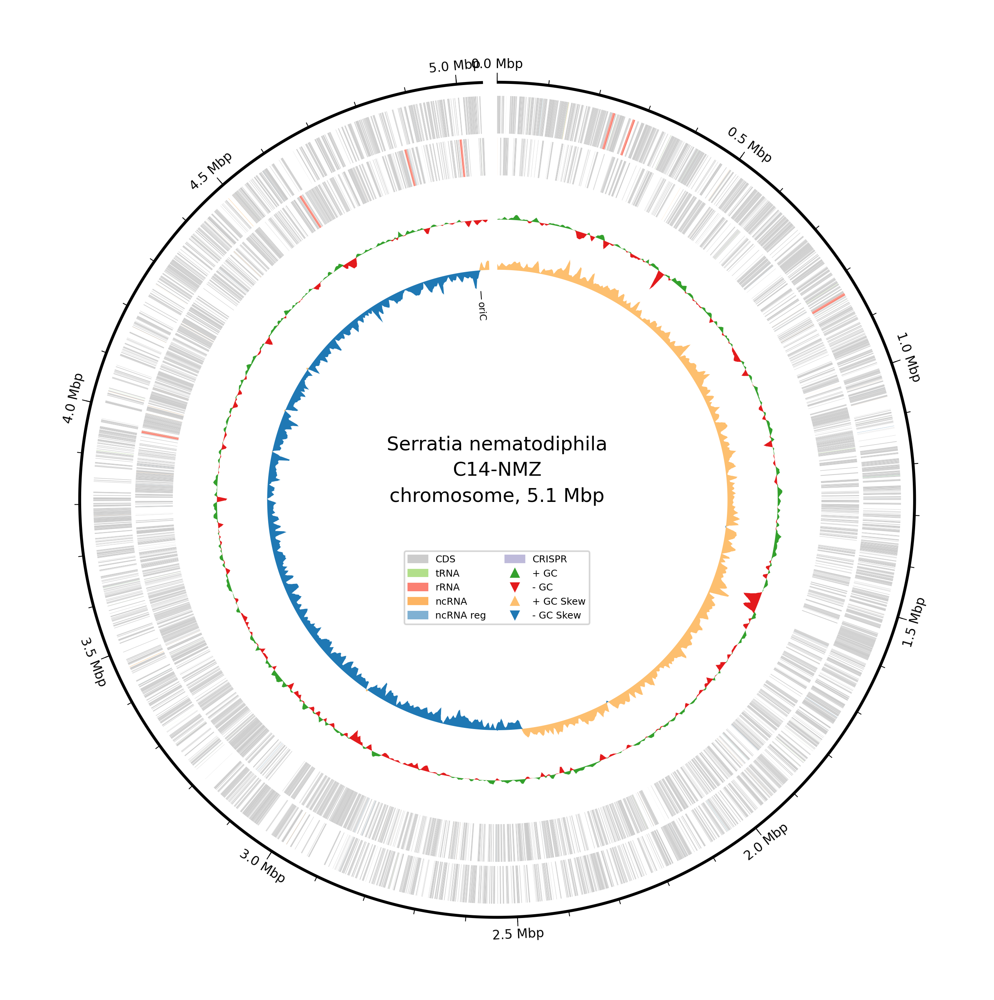
**Figure 1. Circular genomic feature maps of isolates SM-NMZ and C14-NMZ.** Bakta-annotated circular representations of **(A)** SM-NMZ (5.0 Mbp, comprising the circular chromosome and a ~3.58 kb circular plasmid) and **(B)** C14-NMZ (5.1 Mbp circular chromosome). Concentric rings from outside to inside display: (1) Genomic coordinate markers (Mbp) with `oriC` origin of replication; (2) Forward-strand coding sequences (CDS, gray); (3) Reverse-strand CDS (gray), with highlighted structural and non-coding RNA features including tRNA (light green), rRNA (coral), ncRNA (orange), regulatory ncRNA (blue), and CRISPR arrays (purple); (4) GC content plot (+ deviation in green, − in red); and (5) GC skew plot (+ skew in light orange, − skew in blue).

Table 1. Comparative genomic and proteomic annotation features of isolates SM-NMZ and C14-NMZ.

| Genomic / Annotation Metric | SM-NMZ | C14-NMZ |
| :--- | :---: | :---: |
| Genome Size (Mbp) | 4.974 | 5.051 |
| Total Gene / Feature Count | 4,794 | 4,850 |
| G + C Content (%) | 59.8 | 59.8 |
| Coding Sequences (CDS) | 4,566 | 4,626 |
| rRNA Genes | 22 | 22 |
| tRNA / tmRNA Genes | 91 + 1 (92) | 91 + 1 (92) |
| Genes Assigned to UniRef | 4,542 | 4,613 |
| Genes Assigned to RefSeq | 3,682 | 4,205 |
| Genes Assigned to COGs | 3,456 | 3,496 |
| Genes Assigned to KEGG / KO | 1,470 | 1,513 |
| Hypothetical Proteins (No Function Prediction) | 127 | 100 |
| Pseudogenes | 9 | 5 |
| Regulatory ncRNAs (Bakta `ncRNA-region`) | 60 | 56 |
| Additional Replicon (Plasmid) | 1 circular plasmid (~3,581 bp) | None (0) |

*Table 1 note.* Values are derived from the paired Bakta v1.12.0 summary and TSV outputs. Total feature count includes all Bakta feature rows; UniRef, RefSeq, COG, and KEGG/KO values count CDS rows carrying the corresponding database cross-reference; tRNA and tmRNA values are shown separately and as a combined total; and regulatory ncRNAs correspond to Bakta `ncRNA-region` features.

### 2. Taxonomic Identity and Whole-Genome Comparisons

The TYGS whole-genome distance phylogram places SM-NMZ near the *S. marcescens* references and C14-NMZ beside *S. nematodiphila* DSM 21420^T^ (**Figure 2**).

Using the recommended d4 dDDH formula, SM-NMZ showed 95.7% relatedness (confidence interval [C.I.], 94.2–96.8%) to KCTC 42172, labelled *S. marcescens* subsp. *sakuensis* in the TYGS export, and 90.7% (88.4–92.5%) to *S. marcescens* ATCC 13880^T^. C14-NMZ showed its highest relatedness to *S. nematodiphila* DSM 21420^T^ at 85.5% (82.8–87.8%). Cross-comparisons also exceeded the 70% species threshold: SM-NMZ–DSM 21420, 74.7%; C14-NMZ–ATCC 13880, 73.7%; and C14-NMZ–KCTC 42172, 73.9%. The direct SM-NMZ–C14-NMZ comparison was 74.2% (71.2–77.0%). Accordingly, TYGS identified both queries as *S. marcescens* within species cluster 6, while separating SM-NMZ with ATCC 13880/KCTC 42172 in subspecies cluster 11 and C14-NMZ with DSM 21420 in subspecies cluster 10. These numbered clusters describe the server's operational grouping and do not establish formal subspecies names [30].

GTDB-Tk ANI screening [8,19] assigned SM-NMZ to *S. marcescens* (98.86% ANI; alignment fraction [AF], 0.947 to GCF_017299535.1) and C14-NMZ to *S. nematodiphila* (98.22%; AF, 0.932 to GCF_000738675.1). C14-NMZ's 96.82% ANI to the *S. marcescens* representative was below that representative's 96.86% circumscription radius. Thus, the nearest-reference affinities agree across the analyses, but their species assignments differ for C14-NMZ. We retain the GTDB affiliations with this explicit qualification and use isolate names throughout the comparative analysis. The TYGS grouping does not by itself resolve nomenclatural synonymy; LPSN retains *S. marcescens* and *S. nematodiphila* as correct names and treats subsp. *sakuensis* as a synonym within *S. marcescens* [36].

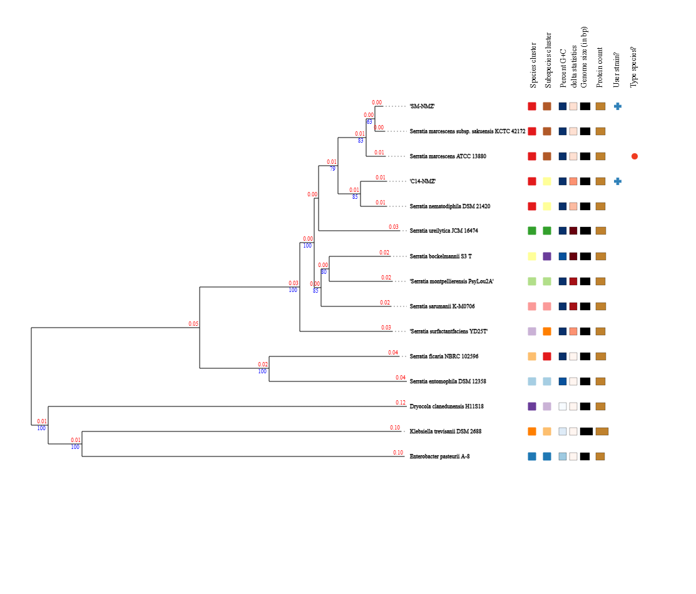

**Figure 2. Whole-genome distance phylogram of SM-NMZ, C14-NMZ and selected type-strain references.** TYGS analyzed the final Dorado-polished assemblies using GBDP trimming distances (formula d5) and FastME v2.1.6.1 with SPR postprocessing and midpoint rooting. Red branch labels show GBDP distances; blue labels show pseudo-bootstrap support above 60% from 100 replicates (mean branch support, 85.9%). Right-hand columns encode species/subspecies clusters, G + C content and delta statistics, genome size, TYGS protein count, user strains (+) and the type species. Both focal isolates share species cluster 6 but occupy different subspecies clusters. TYGS protein counts (4,569 and 4,628) derive from its own predictions and are distinct from Bakta CDS counts in Table 1. Reference names reproduce the supplied export, including the historical subsp. *sakuensis* label.

### 3. Secondary Metabolite Biosynthetic Gene Clusters, Metabolic Profiles, and Comparative Virulence-Factor Profiling

Genome mining with antiSMASH v8.0.4 [2] detected 11 BGC regions on the chromosome of each isolate (**Figure 3A, B**). In SM-NMZ, the region products were NRP-metallophore/NRPS (Region 1), NRPS-like (Region 2), beta-lactone (Region 3), terpene-precursor (Region 4), prodigiosin (Region 5), azole-containing RiPP (Region 6), NRPS (Regions 7 and 9–11), and redox-cofactor (Region 8). C14-NMZ carried NRP-metallophore/NRPS (Region 1), beta-lactone (Region 2), ranthipeptide (Region 3), terpene-precursor (Region 4), prodigiosin (Region 5), azole-containing RiPP (Region 6), opine-like-metallophore (Region 7), redox-cofactor (Region 8), and NRPS (Regions 9–11). The shared redox-cofactor regions contain conserved PQQ-associated *pqqA*–*pqqF* annotations, whereas the beta-lactone and terpene-precursor labels remain class-level calls without a named-product assignment. All 11 region records were internal to the chromosome (`contig_edge=False`); the shared region numbers are ordinal positions within each run and do not imply homologous loci.

The shared Region 1 call combines NRP-metallophore and NRPS rules and includes enterobactin/siderophore-associated annotations (`entF`/`entF2`, `mbtH`, `entS`, `entE`, and related genes). Whole-cluster ClusterBlast comparisons were strong among Serratia homologues, but the MIBiG matches were partial: the Region 1 trichrysobactin-like comparisons involved only six proteins at roughly 47–69% identity, while Region 9 received viobactin- and trichrysobactin-like matches involving only five or six proteins at roughly 47–78% identity. These comparisons support siderophore-associated/metallophore biosynthetic potential, not assignment of trichrysobactin, viobactin, or another named product. C14-NMZ Region 7 is more specifically annotated as an opine-like metallophore, with source annotations for `CntM` and `CntL` and a six-protein yersinopine MIBiG match (64–86% identity, but one hit only approximately 47% covered); it is therefore best described as yersinopine-like potential rather than confirmed yersinopine.

The azole-containing RiPP call in Region 6 of both isolates is rule-based and supported by YcaO cyclodehydratase and Radical-SAM/PF04055 features, but neither record assigns a precursor peptide or named product. C14-NMZ’s Region 3 ranthipeptide call is supported by PqqD_RRE together with PF04055/SPASM features in the local Pqq-associated cassette, although no mature product is named. In contrast, the Region 5 prodigiosin calls are comparatively specific: the antiSMASH rule combines PPDK_N, AMP-binding, PP-binding, and PKS_KS domains, and the core MIBiG prodigiosin match covers 16 proteins at 87–100% identity with near-full-length coverage in both isolates. The conserved *pig* locus corresponds to the characterized 14-gene *Serratia* prodigiosin biosynthetic architecture [16], and its occurrence alongside the red/pink culture phenotype supports prodigiosin-associated pigment production.

The shared Region 11 NRPS should be described as Serrawettin W1-associated, not “ririwpeptide.” The source annotations identify a putative Serrawettin W1 synthetase, and each isolate has a complete Ser-selective C–A–PCP–TE module; *swrW* has been genetically and chemically linked to serratamolide (serrawettin W1) biosynthesis in *S. marcescens* [43]. In the SM-NMZ known-cluster output, “ririwpeptide A/B/C” is only a weak one-protein MIBiG match (47% identity and 45.9% coverage), so it is not a valid product assignment. The independent LC-HRMS detection of serrawettin W1 and serratamolide C under the tested conditions is consistent with the antiSMASH hit interpretation.

Finally, the two Region 10 labels should not be conflated. SM-NMZ Region 10 is a conserved, Gap1-like NRPS/acyl-loading cassette [29], with a close ClusterBlast correspondence to the UENF-22GI Gap1 locus (approximately 30 mostly near-full-length proteins, typically 97–100% identity). Its architecture includes three conventional NRPS modules, two with unresolved A-domain substrate predictions, plus a CAL/carrier unit, a malonyl-specific AT–carrier pair, tailoring enzymes, and a separate type-II thioesterase; its product is chemically uncharacterized and the architecture does not support assignment to canonical stephensiolide. C14-NMZ Region 10 is a separate single-module D-Val NRPS, provisionally consistent with a *gcd*-like amphiphilic pathway, and its nearby T6SS is contextual competition machinery rather than evidence that the T6SS secretes the NRPS product. The red/pink culture phenotype supports prodigiosin-associated pigment production, while LC-HRMS profiling detected serrawettin W1 and serratamolide C under the tested conditions, providing complementary observations for the corresponding genomic loci.

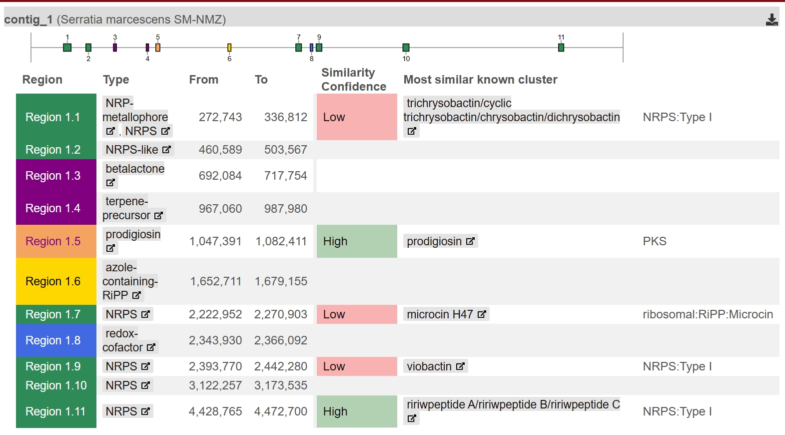
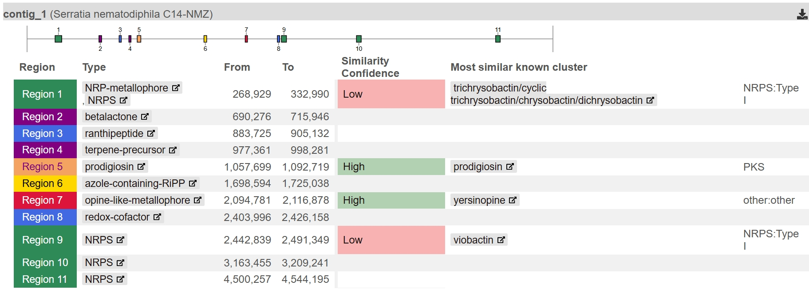
**Figure 3. Genome-wide secondary-metabolite biosynthetic gene-cluster architecture.** antiSMASH v8.0.4 overview maps of the circular chromosomes of **(A)** SM-NMZ and **(B)** C14-NMZ, with 11 detected BGC regions in each isolate. Predicted categories include NRPS/NRPS-like loci, NRP-metallophores, the Region 5 *pig* locus associated with prodigiosin biosynthesis, beta-lactones, terpene precursors, azole-containing RiPPs, ranthipeptides, redox cofactors, and an opine-like metallophore. Color-coded bars distinguish core biosynthetic genes, additional biosynthetic genes, transport-related machinery, and regulatory elements; corresponding metabolite and phenotype observations are summarized in the text.

DRAM profiling [42] used a targeted 98-trait product panel across the 14-genome dataset: 13 KEGG pathway modules, 19 electron-transport-chain modules, and 66 curated functional presence/absence calls. Across all 14 genomes, 90 of 98 traits (91.8%) were invariant, mean pairwise agreement was 97.9%, and the least-similar pair still shared 92.9% of displayed traits; excluding the *Prodigiosinella aquatilis* PA-LS101 outgroup, 95 of 98 traits (96.9%) were invariant among the 13 *Serratia* genomes, mean pairwise agreement was 98.6%, and the minimum agreement was 96.9%. This supports a conserved coarse functional repertoire rather than metabolic identity, because the panel is targeted and agreement partly reflects shared absences or zero-coverage calls (**Figure 4A, B**). All 14 genomes scored 100% for glycolysis, the Entner-Doudoroff pathway, and the pentose phosphate pathway, while the 13 *Serratia* genomes scored 100% for the TCA cycle versus 87.5% for PA-LS101; the glyoxylate-cycle score was 80% in every genome. The shared respiratory signature comprised complete calls for prokaryotic Complex I, fumarate reductase, cytochrome *bd* and cytochrome *o* oxidases, and the prokaryotic F-type ATPase, whereas cytochrome *bc*1 and several cytochrome-*c*-oxidase modules were uniformly absent. Shared pyruvate-, lactate-, alcohol-, and acetate-associated markers indicate annotated fermentative and respiratory options, but the two “acetate => methane” cells do not demonstrate methanogenesis because defining DRAM calls were absent. Within *Serratia*, only prokaryotic succinate-dehydrogenase completeness, the GH43-based arabinan-associated CAZy call, and the K08357 tetrathionate-reduction marker varied; C14-NMZ scored 75% and SM-NMZ 50% for succinate dehydrogenase, while fumarate reductase was complete in every genome. PA-LS101 remained the principal outlier, carrying adjacent nitrogenase markers (*nifH*, *nifD*, and *nifK*) but lacking the nitrate/nitrite profile shared by the *Serratia* genomes. Auxiliary categories included annotated CAZy functions for carbohydrate degradation, nitrate-to-nitrite reduction, tetrathionate reduction, and arsenate-reduction modules (**Figure 4B**).

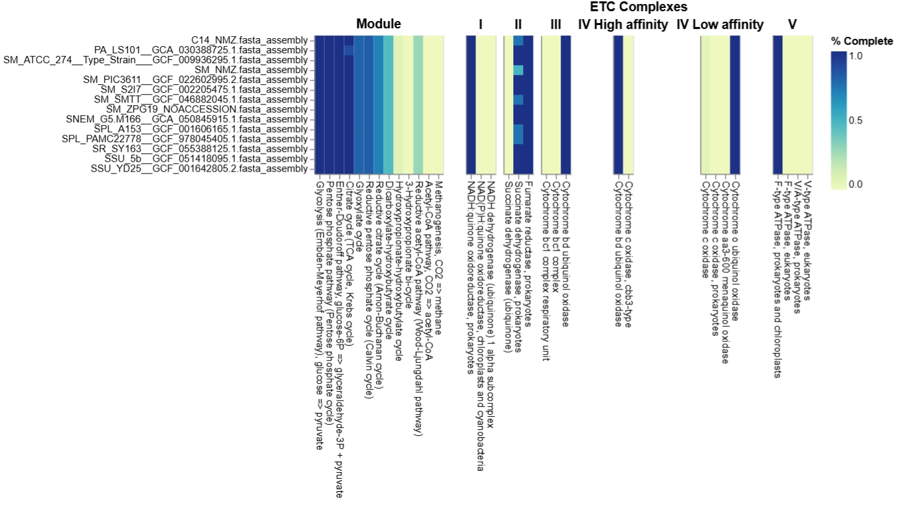
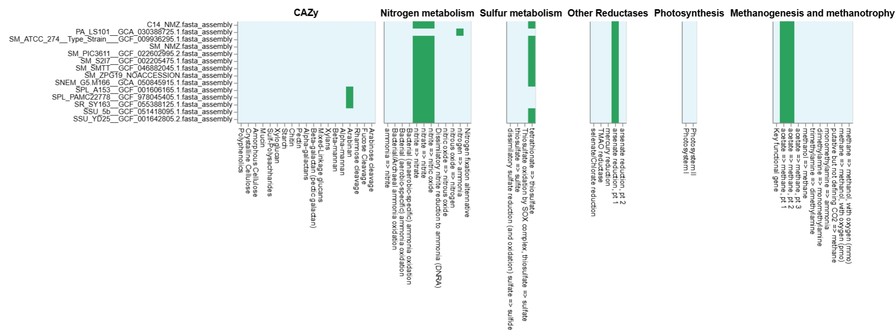
**Figure 4. DRAM module-completeness profiles across the comparative genome panel.** Heatmaps generated by DRAM across 13 *Serratia* genomes and the *Prodigiosinella aquatilis* PA-LS101 outgroup; the color scale reports the percentage of annotated module components, from 0.0 (pale yellow) to 1.0 (dark blue). **(A)** Central-carbon and respiratory categories, including glycolysis, Entner-Doudoroff, pentose phosphate, citrate/TCA, glyoxylate-shunt, reductive acetyl-CoA, and electron-transport modules. **(B)** Auxiliary categories covering CAZy carbohydrate-degradation functions, nitrate-to-nitrite reduction, tetrathionate reduction, arsenate-reduction modules, photosynthesis controls, and methanogenesis/methanotrophy categories.

Comparative profiling against the Virulence Factor Database (VFDB) using `VF_classifier` [28] analyzed the supplied 215-row matrix of 94 VFDB-specific mechanisms across nine genomes (SM-NMZ, C14-NMZ, and seven comparators; **Figure S1**). C14-NMZ and SM-NMZ each represented 56 mechanisms and shared 50 mechanism labels and 99 non-zero matrix entries, demonstrating a substantial common profile despite different total matrix densities (127 cells in C14-NMZ versus 110 in SM-NMZ). C14-NMZ fell within the denser *Serratia* group, close to SNEM G5.M166, SM-S2I7, and SM-SMTT by binary-profile similarity, whereas SM-NMZ most closely resembled SM-ZPG19 (Jaccard similarity, 0.874). Both focal isolates remained much denser than the more divergent SPL-PAMC22778 and *Prodigiosinella aquatilis* PA-LS101 profiles, which contained 68 and 22 non-zero cells, respectively. These contrasts describe similarity to the VFDB reference space rather than a quantitative “virulence burden,” because taxonomic distance, repeated reference representations, and cross-matching of conserved orthologues all influence cell counts.

The most biologically coherent shared clusters were the ShlA–ShlB two-partner hemolysin/secretion pair, the Has hemophore-mediated heme-acquisition system, and type VI secretion system (T6SS) machinery. The primary ShlA–ShlB pair showed 96.7% identity in C14-NMZ and 98.8–99.2% in SM-NMZ; the paired occurrence of the pore-forming ShlA-family protein and its ShlB secretion/activation partner makes this a stronger virulence-associated signal than the isolated lower-identity hemolysin and phospholipase rows, consistent with the experimentally established role of ShlB in ShlA secretion and activation [37]. Both isolates also contained all seven Has entries (`hasA`, `hasB`, `hasD`, `hasE`, `hasI`, `hasR`, and `hasS`), consistent with genomic capacity for hemophore export, heme capture and uptake, and heme-responsive regulation; HasA was originally demonstrated to release heme from hemoglobin and to be required for heme acquisition in *S. marcescens* [26]. This cluster was especially close to the canonical *Serratia* reference in SM-NMZ (96.7–99.6%) but remained strongly conserved in C14-NMZ (90.1–97.3%). T6SS-associated matches were similarly extensive: each isolate had 32 non-zero cells across 12 VFDB mechanism labels, including all ten T6SS-1 entries spanning sheath, baseplate, membrane, ATPase, Hcp, and VgrG-related components. The many additional HSI-1, T6SS-II, T6SS-III, and species-named T6SS labels most likely provide overlapping support for conserved T6SS orthologues, however, and should not be counted as separate secretion systems without coordinate-resolved locus reconstruction. Together with broad flagellar/chemotaxis homologs, AcrAB-family efflux proteins, and oxidative-stress factors, these clusters define a shared genomic profile centered on motility, iron acquisition, efflux-associated stress tolerance, and T6SS-associated interbacterial competition, a role demonstrated for the *S. marcescens* Db10 T6SS [32].

The clearest focal-isolate contrast was not the presence or absence of this shared core, but the strength and breadth of particular reference matches. SM-NMZ was closer to the canonical *Serratia* ShlA–ShlB and Has references and carried several isolate-specific singleton labels, including `vasH` within a T6SS reference and an `mtrD`-labelled RND transporter hit; neither singleton alone establishes an additional complete T6SS or MtrCDE pump. C14-NMZ, by comparison, had more motility cells (31 versus 25), a broader nutritional/metabolic-factor profile (36 cells across 16 mechanisms versus 28 across 13), and a markedly richer capsule-reference footprint: five Capsule VF0465 rows were detected in C14-NMZ and none in SM-NMZ, while a second capsule group contained three C14-NMZ entries but only one SM-NMZ entry. C14-NMZ also carried a 100% `pchH` match and additional partial pyoverdine-, achromobactin-, and other siderophore-reference matches, whereas both isolates shared partial enterobactin-associated genes. These differences suggest stronger C14-NMZ similarity to the capsule and siderophore reference space represented in VFDB, not a defined capsule serotype or production of the named siderophores, which would require locus synteny, pathway-completeness, and metabolite evidence.

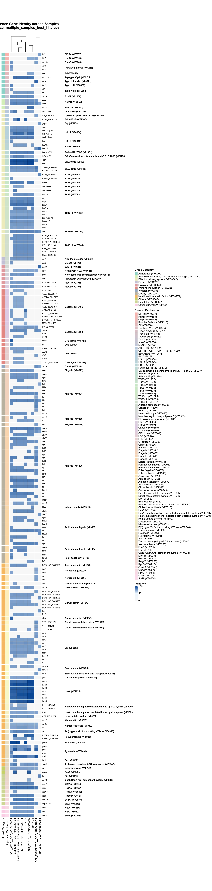
**Figure S1. Comparative virulence-factor landscape of *Serratia* isolates (VFDB / `VF_classifier`).** Hierarchically clustered sequence-identity heatmap (0–100%, light to dark blue) of the 215-row VFDB matrix across nine genomes. Rows are grouped by broad category and specific mechanism, including T6SS-associated proteins, flagellar apparatus, ShlA–ShlB proteins, HasA-related iron-acquisition factors, enterobactin-like genes, and other siderophore-reference homologs. The profile shows conserved and divergent sequence-match patterns associated with environmental persistence, motility, iron acquisition, secretion, and competition. (*Designated as Supplementary Figure S1 because of its vertical dimensions*).

### 4. Hydrocarbonoclastic Potential and Biosurfactant / Pour Point Depressant (PPD)-Associated Genomic Potential
The distribution of hydrocarbon-degradation marker genes (HADEG) and the syntenic conservation of candidate biosurfactant/bio-emulsifier loci (serrawettin, prodigiosin) are examined in relation to PPD, alkane mobilization, and surface-tension reduction. This application context is supported by experimental reports that microbial biosurfactants can reduce the pour point of waxy crude oil [12], although such performance cannot be inferred from genomic markers alone.

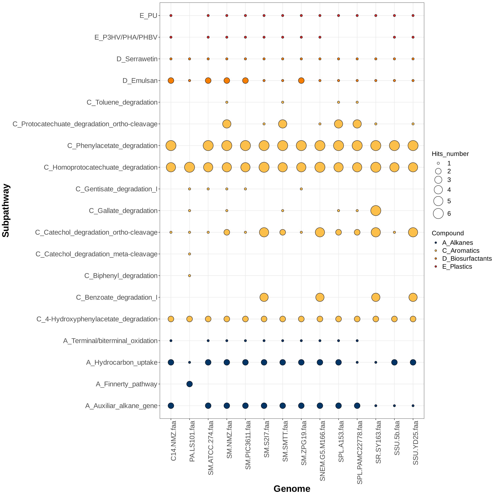
**Figure 5. Genomic repertoire of hydrocarbon-degradation and biosurfactant marker genes (HADEG).** Bubble plot illustrating the distribution and normalized hit counts of curated aerobic hydrocarbon-degradation marker genes across the 14-genome dataset. Subpathways on the Y-axis are grouped into four major classes: **A_Alkanes** (dark blue circles: hydrocarbon uptake, alkane terminal/biterminal oxidation, and auxiliary alkane-degradation genes), **C_Aromatics** (yellow circles: phenylacetate, homoprotocatechuate, protocatechuate ortho-cleavage, catechol ortho/meta-cleavage, benzoate, and gentisate degradation), **D_Biosurfactants** (orange circles: serrawettin-associated phosphopantetheinyl-transferase and capsule/EPS-associated `wzb`/`wzc` markers), and **E_Plastics** (red circles: PU and PHA/PHBV degradation). Bubble diameters correspond to normalized gene-copy hit numbers (1 to 6).

The HADEG profile places C14-NMZ and SM-NMZ in a shared aromatic-processing and surface-matrix pattern. In both isolates, the alkane-associated rows contain two hydrocarbon-uptake hits (`blc` and `fadL`), one terminal/biterminal-oxidation hit, and an auxiliary `ssuD`-like marker; neither focal profile contains the Finnerty-pathway markers. The same pair of isolates also carries two 4-hydroxyphenylacetate markers (`hpaB`/`hpaC`), five homoprotocatechuate markers, six phenylacetate markers, the `wzb`/`wzc` pair in the HADEG “Emulsan” row, a single `pswP`-like serrawettin-associated marker, and one `hbd` and one `pueA` entry in the plastics rows. SM-NMZ is distinguished by four protocatechuate-ortho-cleavage markers and single gentisate, gallate, and `pobA` markers; C14-NMZ has only the shared `pcaF`-like hit in the catechol-ortho row. Thus, the bubble plot shows a conserved aromatic and surface-associated core, with a broader aromatic marker footprint in SM-NMZ rather than a complete alkane-initiation signature.

The GenBank records resolve the largest shared aromatic bubbles as coherent loci. C14-NMZ (`OJMJKD_002635–OJMJKD_002690`) and SM-NMZ (`NNLMDO_002625–NNLMDO_002680`) each contain an almost perfectly syntenic 12-gene `hpa` cassette comprising pathway regulation, the HpaX permease, HpaBC hydroxylation, HpaD extradiol cleavage, and downstream HpaE–I processing. This organization matches the characterized bacterial 4-hydroxyphenylacetate pathway, which converts 4-hydroxyphenylacetate through homoprotocatechuate to central metabolic intermediates [38]. Both genomes also carry tightly organized 14-gene `paa` blocks—`OJMJKD_015005–OJMJKD_015070` in C14-NMZ and `NNLMDO_014780–NNLMDO_014845` in SM-NMZ—with PaaK-mediated activation, the PaaABCDE multicomponent epoxidation system, ring processing, and CoA-linked assimilation; these steps correspond to the experimentally resolved phenylacetyl-CoA pathway [47]. The HADEG 4-hydroxyphenylacetate, homoprotocatechuate, and phenylacetate rows therefore correspond to complete neighborhood-level pathway architectures, and are more informative than isolated aromatic-enzyme hits. Their substrate space is most consistent with oxygenated aromatic compounds derived from plant, amino-acid, or fermentation chemistry that can enter mixed hydrocarbon environments.

The SM-NMZ-specific aromatic bubbles are also supported by linked GenBank neighborhoods. The `pcaI–pcaJ–pcaF–pcaB–pcaD–pcaG–pcaH` branch at `NNLMDO_014970–NNLMDO_015005`, together with the separate `pobA–pcaK` entry module at `NNLMDO_011765–NNLMDO_011770`, provides a coherent 4-hydroxybenzoate-to-protocatechuate pathway matching the established PobA/Pca beta-ketoadipate route [40]. The `maiA–fumaryl-intermediate hydrolase–gtdA` cassette at `NNLMDO_016045–NNLMDO_016065` likewise supports gentisate processing [40]. The `pobA` hit is therefore best read as 4-hydroxybenzoate hydroxylation, despite its HADEG placement in the “toluene degradation” row. In C14-NMZ, the corresponding `pcaF` is embedded within the `paa` locus and occurs without the upstream `pcaGHBDIJ` branch; neither isolate carries a complete canonical `catABC` catechol pathway or a complete `ben`, `tod/tmo`, `xyl`, `nah/ndo`, or `bph` upper-aromatic system.

The shared *hpa/paa* organization and additional SM-NMZ aromatic regions are illustrated in **Figure 6**.

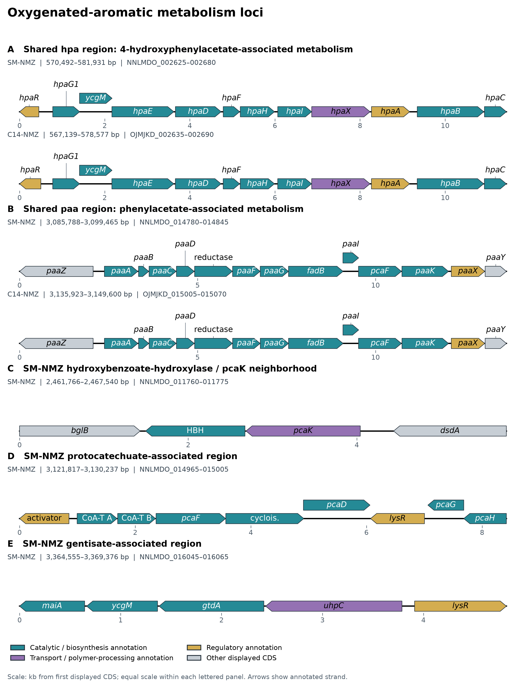

**Figure 6. Genomic organization of oxygenated-aromatic metabolic candidates.** **(A)** Shared *hpa* loci associated with 4-hydroxyphenylacetate metabolism. **(B)** Shared *paa* loci associated with phenylacetate metabolism. **(C)** SM-NMZ's hydroxybenzoate-hydroxylase/*pcaK* neighborhood. **(D)** Its protocatechuate-associated region. **(E)** Its gentisate-associated region. Only SM-NMZ is shown in C–E; downstream pathway assignments remain partly unresolved. HBH denotes the annotated hydroxybenzoate-hydroxylase candidate; other labels retain source gene names or abbreviate product descriptions. Arrows preserve annotated strand and spacing, with equal physical scale within each lettered panel.

The alkane rows similarly require their GenBank context. Both genomes contain focal K20938/LadA-family candidates (`OJMJKD_015520` in C14-NMZ and `NNLMDO_015255` in SM-NMZ), together with `FadL`, `FadD`, `fadE–fadBA`, `fadJI`, `aceAB`, and multiple alcohol- and aldehyde-dehydrogenases that provide substantial downstream fatty-acid and oxidized-carbon assimilation. However, neither record contains a convincing membrane `alkB`, `CYP153`, `almA`, or anaerobic `assA/masD` system. The annotated `alkB` genes (`OJMJKD_015585` and `NNLMDO_015315`) are K03919/EC 1.14.11.33 DNA oxidative demethylases, and the putative rubredoxin-NAD reductase annotations occur in `nirBDC` nitrite-reduction neighborhoods. The focal K20938 proteins sit in highly conserved `wrbA–caiA–MFS–metQ–metP–metN–K20938–ydhS–ssuD` neighborhoods enriched for sulfur- and methionine-associated functions. The combined HADEG and GenBank evidence therefore supports LadA-family flavin-monooxygenase candidates and strong downstream carbon assimilation, while leaving direct long-chain alkane hydroxylation unresolved; recent biochemical reassessment likewise found that LadA-family placement alone did not establish the initial long-chain *n*-alkane hydroxylation step [31].

The biosurfactant and polymer rows describe complementary layers of surface activity. HADEG’s single `pswP`-like marker in each isolate is accompanied in the GenBank records by a dedicated, nearly identical single-module serrawettin W1/serratamolide synthetase (`OJMJKD_021505`, 3,939 bp; `NNLMDO_021205`, 3,936 bp) and phosphopantetheinyl-transferase candidates, making serrawettin W1 the strongest low-molecular-weight amphiphile signal in the two genomes [43]. Serrawettin W1 has experimentally demonstrated surface-tension reduction, emulsion activity, and enhancement of hydrocarbon bioavailability in another *S. marcescens* strain [53]. By contrast, the HADEG “Emulsan” row consists only of generic `wzb`/`wzc` markers. GenBank context identifies these genes as part of *Serratia* group-1 capsule loci, not the characterized 27-kb, 20-ORF *Acinetobacter* RAG-1 `wee` system [33]. Each isolate also contains a distinct second EPS2 locus between `narG` and `narK`: the capsule loci use a `galU–galF-like–wza–wzb–wzc` scaffold and WcaJ initiation, whereas EPS2 uses WecA, Wza, Wzc, Wzx, Wzy, and glycosyltransferases to initiate a chemically distinct GlcNAc-containing repeat. Distal Wzi homologs, separate proximal O-antigen regions, and complete cellulose (`bcs`) loci further expand the envelope-polysaccharide repertoire; SM-NMZ additionally carries the complete `pgaDCBA` PNAG biofilm-polysaccharide locus, which is absent from C14-NMZ. PNAG synthesized by `pgaABCD` is an established intercellular adhesin and biofilm-matrix component [49], while extracellular polymeric matrices more generally promote cellular cohesion and structured microbial aggregates [14]. These loci therefore support capsule/EPS/cellulose/PNAG matrix potential, whereas serrawettin is the clearer candidate for interfacial spreading.

The capsule, EPS2, cellulose and PNAG-associated genomic arrangements distinguish shared matrix-associated systems from the SM-NMZ-specific contiguous *pgaDCBA* locus (**Figure 7**).

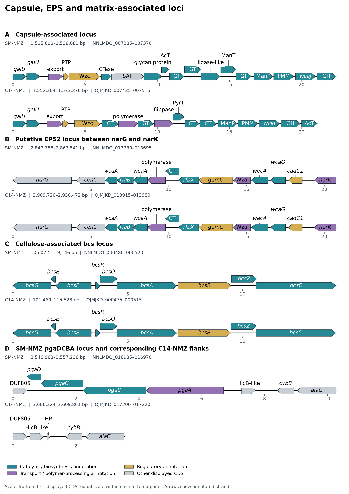

**Figure 7. Capsule, EPS and matrix-associated loci in the focal isolates.** **(A)** Capsule-associated loci. **(B)** Putative EPS2 regions between *narG* and *narK*. **(C)** Cellulose-associated *bcs* regions. **(D)** SM-NMZ's contiguous *pgaDCBA* locus and the corresponding C14-NMZ interval between conserved flanks. C14-NMZ's separate *pgaB* homolog (`OJMJKD_020200`) lies outside the interval shown. Labels follow source gene names or compact product descriptions; repeated *galU* and *bcsE* labels preserve the original annotations. Arrows show annotated strand, with equal physical scale within each lettered panel. Colors distinguish broad annotation classes, rather than sequence identity or demonstrated activity.

The two plastics rows are marker-level signals rather than complete pathway calls: `pueA` is annotated in the GenBank notes as an extracellular lipase, consistent with the experimentally characterized *Pseudomonas chlororaphis* PueA polyurethane esterase/lipase [46], but the isolated `hbd`-like hit is not accompanied by a `phaCAB` biosynthesis locus. Taken together, the HADEG plot and neighborhood analysis characterize C14-NMZ and SM-NMZ as surface-active *Serratia* with strong conserved aromatic and oxidized-carbon processing potential. SM-NMZ has the broader aromatic repertoire through protocatechuate and gentisate branches, while both isolates share the hpa/paa core, serrawettin-associated machinery, cellulose and capsule/EPS systems, and downstream fatty-acid assimilation. The combined profile is more consistent with aromatic-carbon turnover and polymer-supported emulsion or biofilm stabilization than with unqualified broad-spectrum alkane degradation or classical emulsan production.

At the serrawettin-associated locus, SM-NMZ and C14-NMZ have an almost completely collinear 43.9-kb neighborhood (**Figure 8**). In both isolates, the single-module `swrW` synthetase lies immediately downstream of `lpxO–lpxP–pyrG` and upstream of the oppositely oriented `lrgB–lrgA` pair, `lysR`, and `nhaP`; the two SwrW proteins share 98.9% amino-acid identity. Their extended upstream architecture is also conserved from `msrP–msrQ–aroQ–accB–accC` through `yhdT–panF–prmA–dusB–fis`. SM-S217 and SNEM-G5.M166 retain the C14-NMZ-like organization on both sides of `swrW`, whereas a local SM-NMZ difference is the absence of the downstream `lysR` found between `bhsA` and `fabG` in C14-NMZ. SM-SMTT and SM-ZPG19 preserve the same central locus but replace the focal-isolate `DUF1471–cyclase` pair downstream of `fabG` with a `ywnA–DUF1360–methyltransferase` cassette. Collinearity declines more sharply in SPL-PAMC2277, where part of the upstream `cupin–L-lactate dehydrogenase–Smc–MFS` segment is absent and an A-domain-annotated single-module NRPS of comparable size occupies the synthetase position. In SSU-YD25, the corresponding interval expands to the 5,926-aa, five-module solanimycin NRPS `solG` between otherwise recognizable `pyrG` and `lrgBA` anchors, and the distal downstream block is extensively remodeled. PA-LS101 lacks this shared backbone and instead contains a distinct multi-enzyme NRPS/PKS neighborhood, marking the strongest architectural departure from the focal isolates.

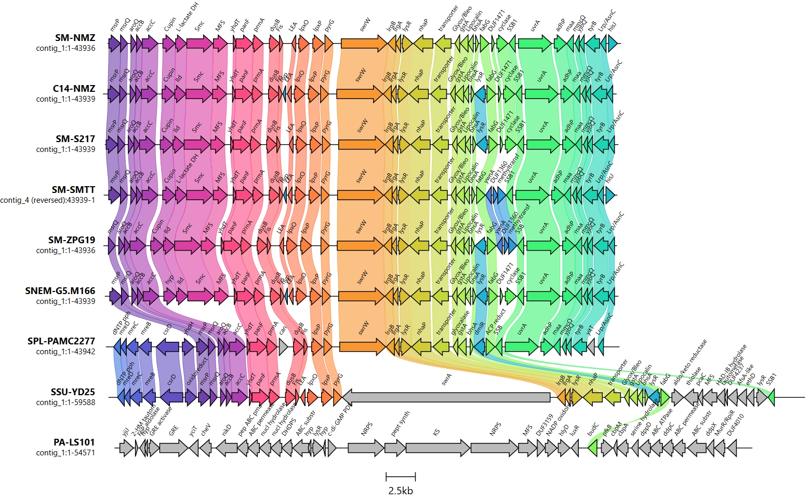
**Figure 8. Genomic synteny and neighborhood architecture of a serrawettin-associated locus.** Comparative gene-cluster alignment constructed with `clinker` (scale bar = 2.5 kb) detailing the serrawettin-associated non-ribosomal peptide synthetase (*swrW*, orange block arrow) across SM-NMZ, C14-NMZ, and seven comparative genomes. Flanking conserved genomic architecture highlights upstream cell division/metabolism genes (*msrP*, *aroQ*, *lld*, *Smc*, *MFS*, *yhdT*, *panF*, *dusB*, *fis*, *lpxOP*, *pyrG*) and downstream transport/stress-response genes (*lrgBA*, *lysR*, *nhaP*, *gstA*, *lipocalin*, *fabG*, *SSB1*, *uvrA*, *adhP*, *tyrB*). LC-HRMS profiling, which detected serrawettin W1 and serratamolide C, provides experimental confirmation of serrawettin-associated metabolite production under the tested conditions. Connecting colored linkages represent pairwise amino-acid sequence identity.

The prodigiosin-associated comparison shows stronger conservation of the biosynthetic core than of its chromosomal boundaries (**Figure 9**). SM-NMZ and C14-NMZ share the same continuous, co-oriented `pigN–pigM–pigL–redY–pksM–pigI–pigH–pigG–pigF–pigE–pigD–pigC–pigB–pigA` block, bounded upstream by `dacB–ybaK–traB–copZ` and downstream by `cueR–ybbJ–hflC`; homologous proteins across their complete 35.0-kb windows share 95.8–100% identity. SM-ZPG19 retains the focal-isolate architecture through the downstream `CFA synthase–cnoX–yqjQ–tesA–ybbA` segment. By contrast, SM-S217, SM-SMTT, and SSU-YD25 conserve the same `pig` core and proximal `cueR–ybbJ–hflC` boundary but transition into an alternative allantoin-associated `allS–ureidoglycolate hydrolase–allR–GCL` neighborhood. SNEM-G5.M166 has the same downstream state and preserves core collinearity despite divergent product labels for several internal homologues. SPL-PAMC2277 maintains a recognizable `pigN–pigA` block, but both boundaries shift to a `yccX–tusE–yccA`-associated upstream segment and an oxidase–`nucA`–phage-protein downstream segment. PA-LS101 shows the most extensive boundary replacement: its `pig` block is embedded between unrelated transport and metal-associated genes upstream and a long downstream region containing reductase, transporter, mobile-element, and siderophore-associated annotations. Thus, the comparison separates a stable prodigiosin biosynthetic backbone in SM-NMZ and C14-NMZ from progressively more divergent genomic contexts across the other isolates.

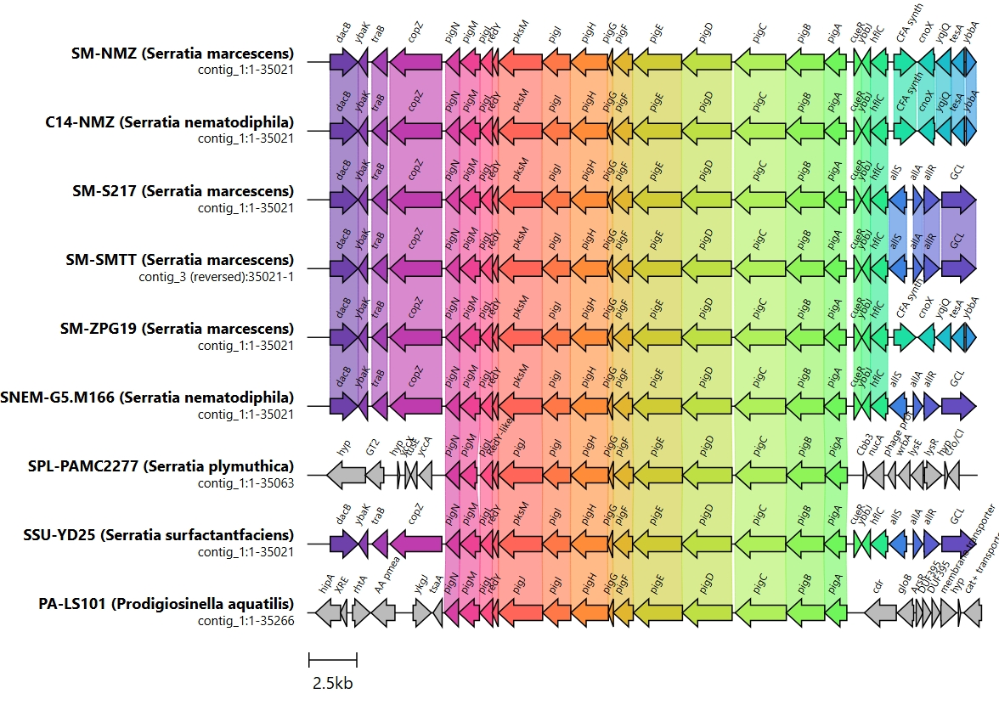
**Figure 9. Syntenic organization of the 14-gene prodigiosin (*pig*) locus.** Gene-cluster comparison map generated using `clinker` (scale bar = 2.5 kb) illustrating the *pigA*–*pigN* arrangement associated with prodigiosin biosynthesis across SM-NMZ, C14-NMZ, and reference *Serratia* genomes. Arrows represent open reading frames with direction of transcription: *pigA*–*pigE* (proline incorporation and MAP condensation, light green), *pigF*–*pigH* (MBC biosynthesis, orange), *pigI*–*pigN* (condensing and tailoring enzymes, pink/red). Flanking boundaries show conserved upstream (*dacB*, *ybak*, *traB*, *copZ*) and downstream (*cueR*, *ybbJ*, *hflC*, *cfa*, *allSAR*) loci. The red/pink-pigmented culture phenotype provides experimental confirmation of the prodigiosin-associated metabolite phenotype under the tested conditions alongside the conserved *pig* arrangement.

### 5. LadA-Associated Group-C Flavin Monooxygenase Phylogeny, Micro-Synteny, and Comparative Pan-Proteome Orthology
The maximum-likelihood analysis placed the focal SM-NMZ (`NNLMDO_015255`) and C14-NMZ (`OJMJKD_015520`) proteins as a short-branched sister pair with 100% UFBoot support (**Figure 10**). The reference long-chain alkane monooxygenase LadA from *Geobacillus thermodenitrificans* NG80-2 (`A4IU28`) and LadA-alpha from *G. thermoleovorans* B23 (`BAM76377.1`) formed a separate pair with 68% support, and the focal and canonical pairs were united within a broader LadA-associated clade with 99% support. This placement separated the focal pair from the reviewed SsuD alkanesulfonate monooxygenases, DszA dibenzothiophene-sulfone monooxygenases, NtaA nitrilotriacetate monooxygenase, LadA-beta, LadB, and bacterial luciferase/LLM-family references included in the 34-sequence, 448-position alignment. These enzymes belong to the structurally related group-C, reduced-FMN-dependent monooxygenases [18]. The tree therefore establishes close orthology between the two focal proteins and places them within the LadA-associated portion of this radiation; their conserved genomic neighborhoods provide the more discriminating evidence for biological context, particularly given recent uncertainty over the direct long-chain-alkane activity of LadA-family proteins [31].

**Figure 10. Maximum-likelihood phylogram placing candidate LadA-family flavin-dependent monooxygenases.** Radial unrooted phylogenetic tree inferred with IQ-TREE 3 under the `Q.PFAM+R3` substitution model (determined by ModelFinder via BIC) from a MAFFT L-INS-i alignment trimmed with ClipKIT smart-gap. The 34-sequence, 448-position dataset included six candidates from each focal isolate and LadA/LadB, SsuD, DszA, NtaA, bacterial luciferase, and other LLM/group-C flavin monooxygenase references. From 1,000 UFBoot replicates, SM-NMZ `NNLMDO_015255` and C14-NMZ `OJMJKD_015520` form a 100%-supported pair within a 99%-supported clade containing canonical LadA `A4IU28` and LadA-alpha `BAM76377.1`.

At the focal-pair scale, the candidate monooxygenases occupy a conserved sulfur/methionine-associated core with distinct flanking genes (**Figure 11**).

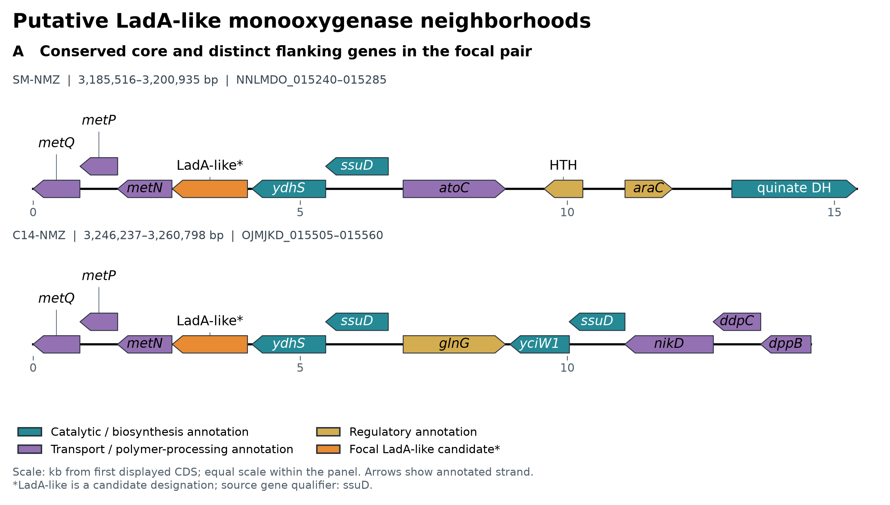

**Figure 11. Genomic neighborhoods of the putative LadA-like candidates.** DNA Features Viewer comparison of SM-NMZ and C14-NMZ. Orange arrows mark `NNLMDO_015255` and `OJMJKD_015520`, respectively; the “LadA-like” label is the manuscript's candidate designation, whereas both source gene qualifiers are *ssuD*. The shared neighborhood includes methionine-transporter genes, *ydhS* and an adjacent *ssuD*-annotated CDS. The flanking regions differ, including the C14-NMZ *glnG–yciW1–ssuD–nik/ddp* extension. Arrows retain annotated strand and genomic spacing on a common scale. Neighborhood conservation and candidate labels do not assign alkane-oxidation activity.

Micro-synteny divided the ten displayed K20938 regions into two architectures rather than a single conserved LadA locus (**Figure 12**). Family I comprises eight 468-aa focal proteins from C14-NMZ, SM-NMZ, SM-ATCC-274, SM-PIC3611, SM-S2I7, SM-SMTT, SM-ZPG19, and SNEM-G5.M166, with 98.72–99.79% pairwise identity and an invariant transcription-normalized core: `ssuD` (K04091)–`ydhS`–focal LadA-alpha-like monooxygenase–`metN–metP–metQ`–MFS/proline transporter–`caiA`/COG1960. The conserved 1-bp `ssuD–ydhS` overlap, 84-bp `ydhS`–focal interval, 7-bp focal–`metN` interval, and overlapping `metNPQ` junctions support a tightly organized redox/monooxygenase–methionine-transport module. C14-NMZ belongs to subtype IA, in which this core adjoins a divergent `glnG` and a second compact `yciW1–ssuD–nikD–ddpC–dppB–ddpA` redox/transport block; SM-S2I7, SM-ZPG19, and SNEM-G5.M166 share this extension. SM-NMZ belongs to subtype IB with SM-ATCC-274, SM-PIC3611, and SM-SMTT, where the corresponding flank instead contains an aliphatic-sulfonate-binding protein, opposing AraC-family regulators, quinate dehydrogenase, and a Na+/H+ antiporter. SM-NMZ is nearly collinear with SM-PIC3611 but lacks the small hypothetical CDS between an AraC regulator and quinate dehydrogenase, while the reversed display of SM-SMTT reflects contig orientation rather than a biological inversion.

Family II comprises the two 456-aa *Serratia plymuthica* proteins from SPL-A153 and SPL-PAMC22778. These proteins are 98.68% identical to each other but only approximately 55% identical to Family I and occupy a distinct `sfnB–focal NtaA-like monooxygenase–metQNP–ssuA` sulfur-acquisition architecture, accompanied by CysJI regulation and encapsulin/cysteine-desulfurase-associated genes. The comparison therefore shows a stable Family-I core with subtype-specific flanking modules in SM-NMZ and C14-NMZ, followed by a sharper architectural transition to the SPL NtaA/Sfn family. ProteinOrtho recovered 10,252 sequence-based orthogroups across the 14 proteomes, of which 2,140 were represented in all genomes. The focal K20938 group contained one protein from each of the eight Family-I isolates and both SPL isolates, but no member from PA-LS101, SR-SY163, SSU-5b, or SSU-YD25. Its ten-member membership captures broad sequence-family homology; the divergent focal identities and conserved neighborhoods resolve that group into the two biologically distinct locus families shown by synteny.

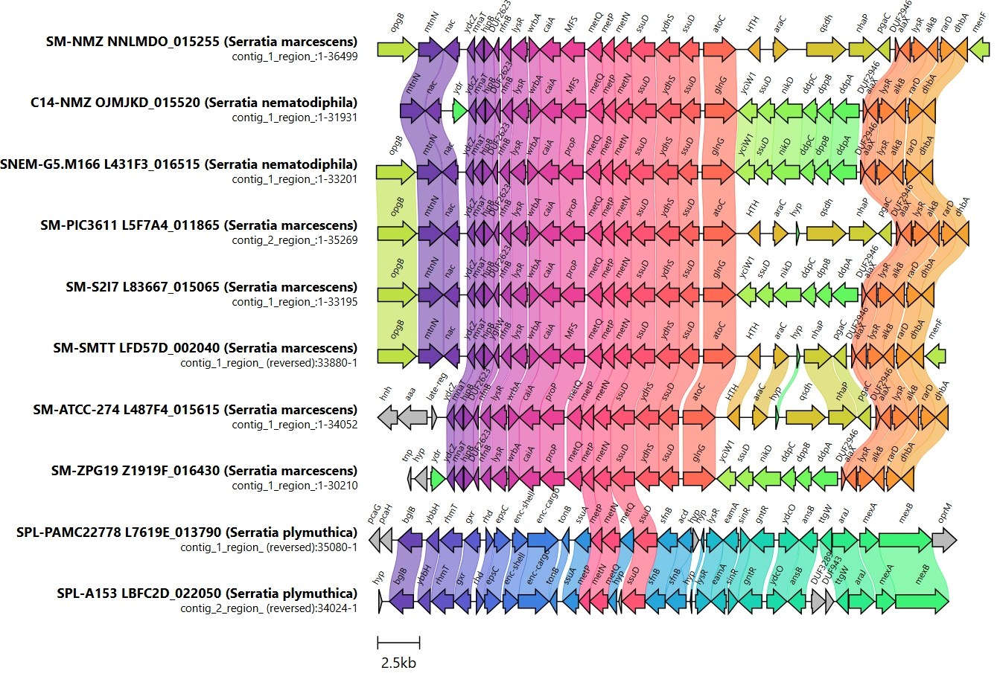
**Figure 12. Micro-synteny and genomic neighborhood of candidate LadA-alpha-like and NtaA/Sfn-associated loci.** Curated `clinker` alignment (scale bar = 2.5 kb) of ten K20938-centered regions. The eight-isolate Family-I architecture contains a conserved `ssuD–ydhS–focal monooxygenase–metNPQ` core, with the C14-NMZ subtype carrying a `glnG–yciW1–additional ssuD–nik/ddp` extension and the SM-NMZ subtype carrying an aliphatic-sulfonate-binding/regulatory extension. The two *S. plymuthica* regions form Family II, in which divergent NtaA-like focal proteins occur in `sfnB–metQNP–ssuA` sulfur-acquisition neighborhoods. Connecting colored bands denote pairwise amino-acid sequence identity and show conserved gene order within, but not between, the two locus families.

> **Study-wide interpretation note:** The analyses in this manuscript characterize genome sequence features, annotation-supported pathway potential, and comparative genomic patterns. Targeted wet-lab experiments are required to validate pathway activity, metabolite production, hydrocarbon transformation, and associated phenotypes under relevant conditions.

## References

1. Benoit, G., Raguideau, S., James, R., Phillippot, L., Urich, T., Quince, C., & Koszul, R. (2024). High-quality metagenome assembly from long accurate reads with metaMDBG. *Nature Biotechnology*, 42, 1378–1383. https://doi.org/10.1038/s41587-023-01983-6
2. Blin, K., Shaw, S., Vader, L., Szenei, J., Reitz, Z. L., Augustijn, H. E., ... & Weber, T. (2025). antiSMASH 8.0: extended gene cluster detection capabilities and analyses of chemistry, enzymology, and regulation. *Nucleic Acids Research*, 53(W1), W32–W38. https://doi.org/10.1093/nar/gkaf334
3. Boonmak, C., Takahashi, Y., & Morikawa, M. (2014). Cloning and expression of three ladA-type alkane monooxygenase genes from an extremely thermophilic alkane-degrading bacterium *Geobacillus thermoleovorans* B23. *Extremophiles*, 18(3), 515–523. https://doi.org/10.1007/s00792-014-0636-y
4. Bouras, G., Grigson, S. R., Papudeshi, B., Mallawaarachchi, V., & Roach, M. J. (2024). dnaapler: A tool to reorient circular microbial genomes. *Journal of Open Source Software*, 9(93), 5968. https://doi.org/10.21105/joss.05968
5. Bouras, G., Sheppard, A. E., Mallawaarachchi, V., & Vreugde, S. (2023). Plassembler: an automated bacterial plasmid assembly tool. *Bioinformatics*, 39(7), btad409. https://doi.org/10.1093/bioinformatics/btad409
6. Buchfink, B., Reuter, K., & Drost, H. G. (2021). Sensitive protein alignments at tree-of-life scale using DIAMOND. *Nature Methods*, 18(4), 366–368. https://doi.org/10.1038/s41592-021-01101-x
7. Camacho, C., Coulouris, G., Avagyan, V., Ma, N., Papadopoulos, J., Bealer, K., & Madden, T. L. (2009). BLAST+: architecture and applications. *BMC Bioinformatics*, 10, 421. https://doi.org/10.1186/1471-2105-10-421
8. Chaumeil, P.-A., Mussig, A. J., Hugenholtz, P., & Parks, D. H. (2022). GTDB-Tk v2: memory friendly classification with the Genome Taxonomy Database. *Bioinformatics*, 38(23), 5315–5316. https://doi.org/10.1093/bioinformatics/btac672
9. Cheng, H., Concepcion, G. T., Feng, X., Zhang, H., & Li, H. (2021). Haplotype-resolved de novo assembly using phased assembly graphs with hifiasm. *Nature Methods*, 18(2), 170–175. https://doi.org/10.1038/s41592-020-01056-5
10. De Coster, W., & Rademakers, R. (2023). NanoPack2: population-scale evaluation of long-read sequencing data. *Bioinformatics*, 39(5), btad311. https://doi.org/10.1093/bioinformatics/btad311
11. De Coster, W., D'Hert, S., Schultz, D. T., Cruts, M., & Van Broeckhoven, C. (2018). NanoPack: visualizing and processing long-read sequencing data. *Bioinformatics*, 34(15), 2666–2669. https://doi.org/10.1093/bioinformatics/bty149
12. El-Sheshtawy, H. S., & Khidr, T. T. (2016). Some biosurfactants used as pour point depressant for waxy Egyptian crude oil. *Petroleum Science and Technology*, 34(16), 1475–1482. https://doi.org/10.1080/10916466.2016.1204317
13. Feng, L., Wang, W., Cheng, J., Ren, Y., Zhao, G., Gao, C., ... & Wang, L. (2007). Genome and proteome of long-chain alkane degrading *Geobacillus thermodenitrificans* NG80-2 isolated from a deep-subsurface oil reservoir. *Proceedings of the National Academy of Sciences*, 104(13), 5602–5607. https://doi.org/10.1073/pnas.0609650104
14. Flemming, H.-C., & Wingender, J. (2010). The biofilm matrix. *Nature Reviews Microbiology*, 8(9), 623–633. https://doi.org/10.1038/nrmicro2415
15. Gilchrist, C. L. M., & Chooi, Y. H. (2021). clinker & clustermap.js: automatic generation of gene cluster comparison figures. *Bioinformatics*, 37(16), 2473–2475. https://doi.org/10.1093/bioinformatics/btab007
16. Harris, A. K. P., Williamson, N. R., Slater, H., Cox, A., Abbasi, S., Foulds, I., ... & Salmond, G. P. C. (2004). The *Serratia* gene cluster encoding biosynthesis of the red antibiotic, prodigiosin, shows species- and strain-dependent genome context variation. *Microbiology*, 150(11), 3547–3560. https://doi.org/10.1099/mic.0.27222-0
17. Hoang, D. T., Chernomor, O., von Haeseler, A., Minh, B. Q., & Vinh, L. S. (2018). UFBoot2: improving the ultrafast bootstrap approximation. *Molecular Biology and Evolution*, 35(2), 518–522. https://doi.org/10.1093/molbev/msx281
18. Huijbers, M. M. E., Montersino, S., Westphal, A. H., Tischler, D., & van Berkel, W. J. H. (2014). Flavin dependent monooxygenases. *Archives of Biochemistry and Biophysics*, 544, 2–17. https://doi.org/10.1016/j.abb.2013.12.005
19. Jain, C., Rodriguez-R, L. M., Phillippy, A. M., Konstantinidis, K. T., & Aluru, S. (2018). High throughput ANI analysis of 90K prokaryotic genomes reveals clear species boundaries. *Nature Communications*, 9, 5114. https://doi.org/10.1038/s41467-018-07641-9
20. Kalyaanamoorthy, S., Minh, B. Q., Wong, T. K. F., von Haeseler, A., & Jermiin, L. S. (2017). ModelFinder: fast model selection for accurate phylogenetic estimates. *Nature Methods*, 14(6), 587–589. https://doi.org/10.1038/nmeth.4285
21. Katoh, K., & Standley, D. M. (2013). MAFFT multiple sequence alignment software version 7: improvements in performance and usability. *Molecular Biology and Evolution*, 30(4), 772–780. https://doi.org/10.1093/molbev/mst010
22. Khot, V., Zorz, J., Gittins, D. A., et al. (2022). CANT-HYD: A curated database of phylogeny-derived hidden Markov models for annotation of marker genes involved in hydrocarbon degradation. *Frontiers in Microbiology*, 12, 764058. https://doi.org/10.3389/fmicb.2021.764058
23. Kolmogorov, M., Yuan, J., Lin, Y., & Pevzner, P. A. (2019). Assembly of long, error-prone reads using repeat graphs. *Nature Biotechnology*, 37(5), 540–546. https://doi.org/10.1038/s41587-019-0072-8
24. Koren, S., Walenz, B. P., Berlin, K., Miller, J. R., Bergman, N. H., & Phillippy, A. M. (2017). Canu: scalable and accurate long-read assembly via adaptive k-mer weighting and repeat separation. *Genome Research*, 27(5), 722–736. https://doi.org/10.1101/gr.215087.116
25. Lechner, M., Findeiß, S., Steiner, L., Marz, M., Stadler, P. F., & Prohaska, S. J. (2011). Proteinortho: detection of (co-)orthologs in large-scale analysis. *BMC Bioinformatics*, 12, 124. https://doi.org/10.1186/1471-2105-12-124
26. Létoffé, S., Ghigo, J. M., & Wandersman, C. (1994). Iron acquisition from heme and hemoglobin by a *Serratia marcescens* extracellular protein. *Proceedings of the National Academy of Sciences*, 91(21), 9876–9880. https://doi.org/10.1073/pnas.91.21.9876
27. Letunic, I., & Bork, P. (2021). Interactive Tree Of Life (iTOL) v5: an online tool for phylogenetic tree display and annotation. *Nucleic Acids Research*, 49(W1), W293–W296. https://doi.org/10.1093/nar/gkab301
28. Liu, B., Zheng, D., Zhou, S., Chen, L., & Yang, J. (2022). VFDB 2022: a general classification scheme for bacterial virulence factors. *Nucleic Acids Research*, 50(D1), D912–D917. https://doi.org/10.1093/nar/gkab1107
29. Matteoli, F. P., Passarelli-Araujo, H., Reis, R. J. A., da Rocha, L. O., de Souza, E. M., Aravind, L., Olivares, F. L., & Venancio, T. M. (2018). Genome sequencing and assessment of plant growth-promoting properties of a *Serratia marcescens* strain isolated from vermicompost. *BMC Genomics*, 19, 750. https://doi.org/10.1186/s12864-018-5130-y
30. Meier-Kolthoff, J. P., & Göker, M. (2019). TYGS is an automated high-throughput platform for state-of-the-art genome-based taxonomy. *Nature Communications*, 10(1), 2182. https://doi.org/10.1038/s41467-019-10210-3
31. Mireles, R., Matthews, A., Teufel, R., & Noda-García, L. (2025). Can flavoprotein monooxygenases functionalize long-chain *n*-alkanes? *PLOS ONE*, 20(9), e0332702. https://doi.org/10.1371/journal.pone.0332702
32. Murdoch, S. L., Trunk, K., English, G., Fritsch, M. J., Pourkarimi, E., & Coulthurst, S. J. (2011). The opportunistic pathogen *Serratia marcescens* utilizes type VI secretion to target bacterial competitors. *Journal of Bacteriology*, 193(21), 6057–6069. https://doi.org/10.1128/JB.05671-11
33. Nakar, D., & Gutnick, D. L. (2003). Involvement of a protein tyrosine kinase in production of the polymeric bioemulsifier emulsan from the oil-degrading strain *Acinetobacter lwoffii* RAG-1. *Journal of Bacteriology*, 185(3), 1001–1009. https://doi.org/10.1128/JB.185.3.1001-1009.2003
34. Oxford Nanopore Technologies. Dorado [Software]. https://github.com/nanoporetech/dorado
35. Parks, D. H., Chuvochina, M., Rinke, C., Mussig, A. J., Chaumeil, P.-A., & Hugenholtz, P. (2022). GTDB: an ongoing census of bacterial and archaeal diversity through a phylogenetically consistent, rank normalized and complete genome-based taxonomy. *Nucleic Acids Research*, 50(D1), D785–D794. https://doi.org/10.1093/nar/gkab776
36. Parte, A. C., Sardà Carbasse, J., Meier-Kolthoff, J. P., Reimer, L. C., & Göker, M. (2020). List of Prokaryotic names with Standing in Nomenclature (LPSN) moves to the DSMZ. *International Journal of Systematic and Evolutionary Microbiology*, 70(11), 5607–5612. https://doi.org/10.1099/ijsem.0.004332
37. Pramanik, A., Könninger, U., Selvam, A., & Braun, V. (2014). Secretion and activation of the *Serratia marcescens* hemolysin by structurally defined ShlB mutants. *International Journal of Medical Microbiology*, 304(3–4), 351–359. https://doi.org/10.1016/j.ijmm.2013.11.021
38. Prieto, M. A., Díaz, E., & García, J. L. (1996). Molecular characterization of the 4-hydroxyphenylacetate catabolic pathway of *Escherichia coli* W: engineering a mobile aromatic degradative cluster. *Journal of Bacteriology*, 178(1), 111–120. https://doi.org/10.1128/jb.178.1.111-120.1996
39. Rojas-Vargas, J. A., Castelán-Sánchez, H. G., & Pardo-López, L. (2023). HADEG: a curated hydrocarbon aerobic degradation enzymes and genes database. *Computational Biology and Chemistry*, 107, 107966. https://doi.org/10.1016/j.compbiolchem.2023.107966
40. Romero-Silva, M. J., Méndez, V., Agulló, L., & Seeger, M. (2013). Genomic and functional analyses of the gentisate and protocatechuate ring-cleavage pathways and related 3-hydroxybenzoate and 4-hydroxybenzoate peripheral pathways in *Burkholderia xenovorans* LB400. *PLOS ONE*, 8(2), e56038. https://doi.org/10.1371/journal.pone.0056038
41. Schwengers, O., Jelonek, L., Dieckmann, M. A., Beyvers, S., Blom, J., & Goesmann, A. (2021). Bakta: rapid and standardized annotation of bacterial genomes via a comprehensive and consistent annotation framework. *Microbial Genomics*, 7(11), 000685. https://doi.org/10.1099/mgen.0.000685
42. Shaffer, M., Borton, M. A., McGivern, B. B., Zayed, A. A., La Rosa, S. L., ... & Wrighton, K. C. (2020). DRAM for distilling microbial metabolism to automate the curation of microbiome function. *Nucleic Acids Research*, 48(16), 8883–8900. https://doi.org/10.1093/nar/gkaa621
43. Shanks, R. M. Q., Stella, N. A., Lahr, R. M., Wang, S., Veverka, T. I., Kowalski, R. P., & Liu, X. (2012). Serratamolide is a hemolytic factor produced by *Serratia marcescens*. *PLOS ONE*, 7(5), e36398. https://doi.org/10.1371/journal.pone.0036398
44. Shaw, J., Marin, M. G., & Li, H. (2026). High-resolution metagenome assembly for modern long reads with myloasm. *Nature Biotechnology*. https://doi.org/10.1038/s41587-026-03053-z
45. Steenwyk, J. L., Buida, T. J., III, Li, Y., Shen, X.-X., & Rokas, A. (2020). ClipKIT: a multiple sequence alignment trimming software for accurate phylogenomic inference. *PLOS Biology*, 18(12), e3001007. https://doi.org/10.1371/journal.pbio.3001007
46. Stern, R. V., & Howard, G. T. (2000). The polyester polyurethanase gene (*pueA*) from *Pseudomonas chlororaphis* encodes a lipase. *FEMS Microbiology Letters*, 185(2), 163–168. https://doi.org/10.1111/j.1574-6968.2000.tb09056.x
47. Teufel, R., Mascaraque, V., Ismail, W., Voss, M., Perera, J., Eisenreich, W., Haehnel, W., & Fuchs, G. (2010). Bacterial phenylalanine and phenylacetate catabolic pathway revealed. *Proceedings of the National Academy of Sciences*, 107(32), 14390–14395. https://doi.org/10.1073/pnas.1005399107
48. Vaser, R., & Šikić, M. (2021). Time- and memory-efficient genome assembly with Raven. *Nature Computational Science*, 1, 332–336. https://doi.org/10.1038/s43588-021-00073-4
49. Wang, X., Preston, J. F., III, & Romeo, T. (2004). The *pgaABCD* locus of *Escherichia coli* promotes the synthesis of a polysaccharide adhesin required for biofilm formation. *Journal of Bacteriology*, 186(9), 2724–2734. https://doi.org/10.1128/JB.186.9.2724-2734.2004
50. Wick, R. R. Filtlong: quality filtering tool for long reads [Software]. https://github.com/rrwick/Filtlong
51. Wick, R. R., Howden, B. P., & Stinear, T. P. (2025). Autocycler: long-read consensus assembly for bacterial genomes. *Bioinformatics*, 41(9), btaf474. https://doi.org/10.1093/bioinformatics/btaf474
52. Wong, T. K. F., Ly-Trong, N., Ren, H., Demotte, P., Banos, H., Roger, A. J., Susko, E., Bielow, C., De Maio, N., Goldman, N., Hahn, M. W., dos Reis, M., Vinh, L. S., Huttley, G., Lanfear, R., & Minh, B. Q. (2026). IQ-TREE 3: Phylogenomic inference software using complex evolutionary models. *Molecular Biology and Evolution*, msag117. https://doi.org/10.1093/molbev/msag117
53. Zhang, K., Tao, W., Lin, J., Wang, W., & Li, S. (2021). Production of the biosurfactant serrawettin W1 by *Serratia marcescens* S-1 improves hydrocarbon degradation. *Bioprocess and Biosystems Engineering*, 44(12), 2541–2552. https://doi.org/10.1007/s00449-021-02625-4
54. Zulkower, V., & Rosser, S. (2020). DNA Features Viewer: a sequence annotation formatting and plotting library for Python. *Bioinformatics*, 36(15), 4350–4352. https://doi.org/10.1093/bioinformatics/btaa213
