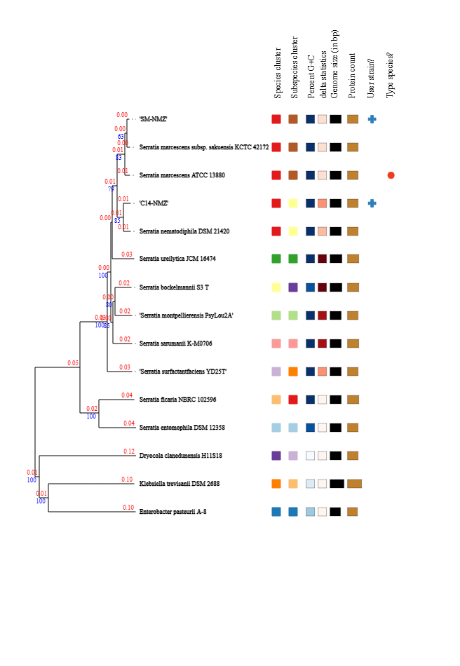
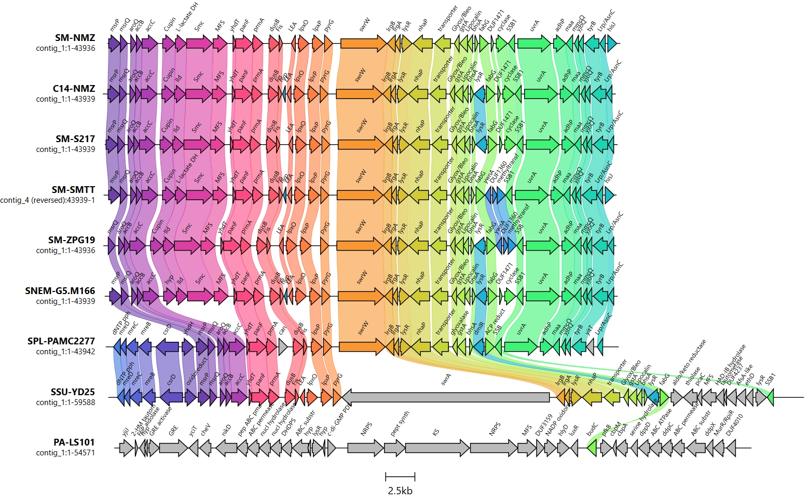
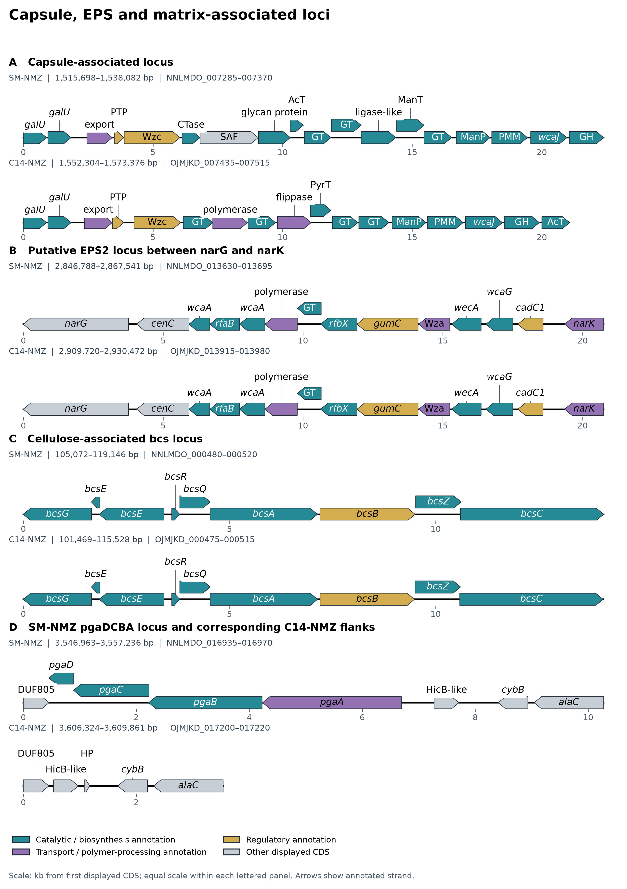
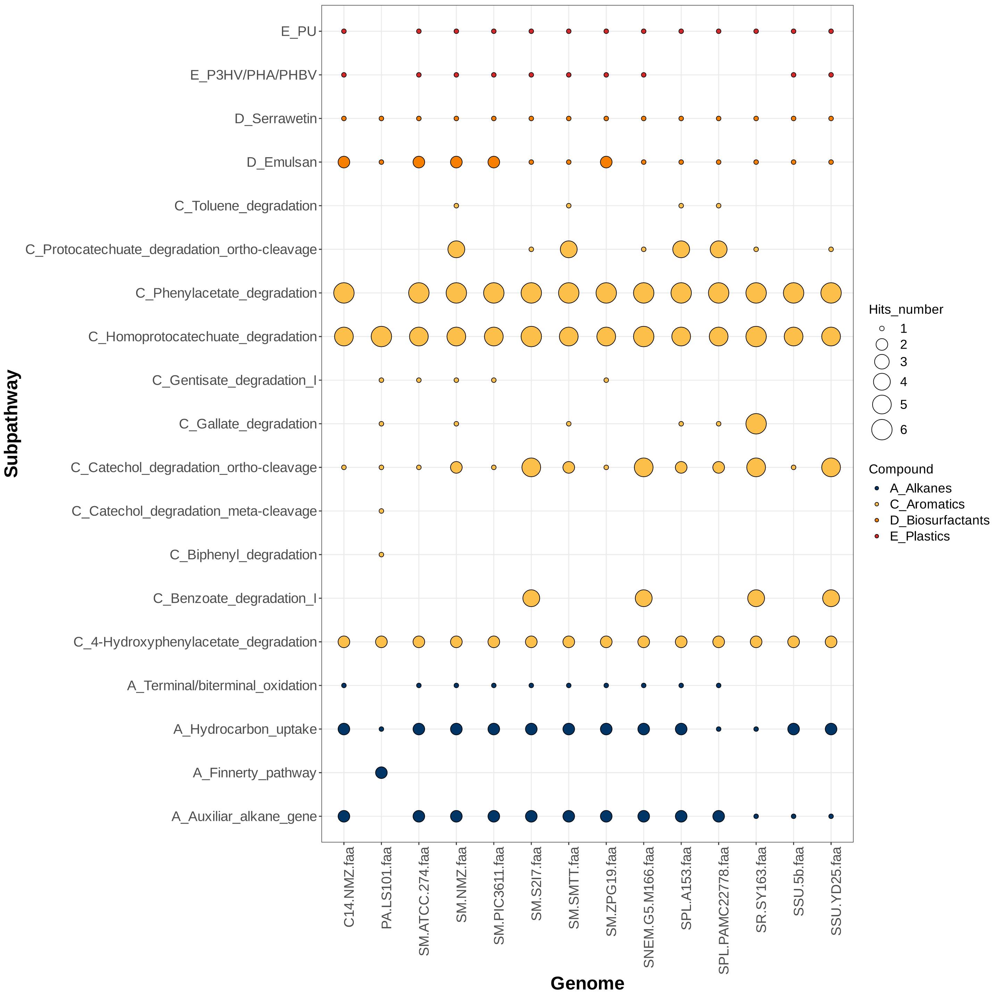
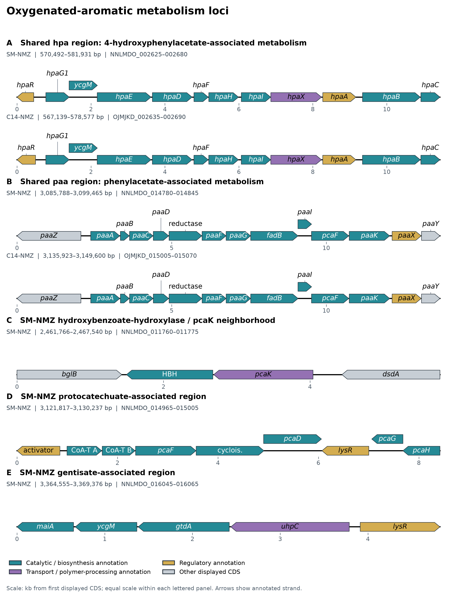
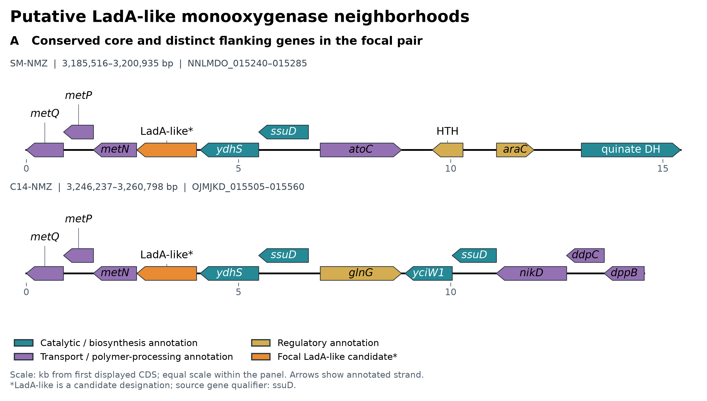

# Manuscript

## Materials & Methods

### A. Whole Genome Sequencing

SM-NMZ and C14-NMZ were subcultured from single colonies in Nutrient Broth for approximately 16–24 h. Genomic DNA was extracted using the GeneAid Presto Mini gDNA Bacteria Kit and assessed with an Implen NP80 NanoPhotometer. Approximately 200 ng was used for library preparation with the Oxford Nanopore Rapid Barcoding Kit 24 V14 (SQK-RBK114.24). Libraries were sequenced on PromethION for approximately 28 h using the `dna_r10.4.1_e8.2_400bps_sup@v5.0.0` basecalling model, followed by demultiplexing and trimming.

### B. De Novo Assembly and Genome Annotation

Read quality was assessed using NanoPlot [8]. Chopper retained reads with quality scores ≥10 and lengths ≥500 bp [7], and Filtlong retained the highest-ranked reads representing 90% of remaining bases [36]. Autocycler combined draft assemblies from seven assemblers and seven subsamples [37]. Assemblies were reoriented using dnaapler [3], polished with Dorado [25], and annotated using Bakta v1.12.0 with database v6.0 [30]. CANT-HYD HMMs were supplied to Bakta for hydrocarbon-associated marker annotation [17].

### C. Taxonomic Identity and Biosynthetic Gene Cluster Analysis

Genome relatedness was assessed using digital DNA–DNA hybridization (dDDH) through TYGS [21] and average nucleotide identity (ANI) screening with GTDB-Tk v2.7.2 against GTDB r232 [6]. This GTDB-Tk run did not require pplacer placement. The final Dorado-polished assemblies were submitted together to TYGS, including both SM-NMZ replicons. GBDP trimming distances (formula d5) informed a midpoint-rooted FastME v2.1.6.1 tree with 100 pseudo-bootstrap replicates; dDDH used GGDC 4.0 and the recommended d4 formula. Biosynthetic gene clusters were identified using antiSMASH v8.0.4 [1].

### D. Metabolic and Biosurfactant-Associated Genomic Profiling

Annotated proteomes were examined using DRAM [31], HADEG [28] and VFDB-based profiling [20]. Locus organization was assessed from curated annotations and clinker comparisons [12]. The comparative panel comprised 14 proteomes: SM-NMZ, C14-NMZ, 11 additional *Serratia* genomes and *Prodigiosinella aquatilis* PA-LS101 as an outgroup. Selected focal-pair neighborhoods were extracted using genbank-parser and rendered using DNA Features Viewer [40], preserving annotated strand and genomic spacing.

### E. Comparative Proteome Orthology and Monooxygenase Phylogeny

ProteinOrtho v6.3.6 with DIAMOND v2.2.5 generated sequence groups and a separate PoFF gene-order analysis [4,18]. Candidate monooxygenases were retrieved using BLASTp (E ≤ 1e-5; query coverage ≥50%) [5] and compared with canonical LadA, B23 LadA-type proteins and related oxidoreductases. Sequences were aligned using MAFFT L-INS-i [16], trimmed using ClipKIT smart-gap [33], and analyzed with IQ-TREE 3 under the ModelFinder-selected Q.PFAM+R3 model, with 1,000 ultrafast bootstrap replicates [14,15,38].

## Results & Discussion

### 1. Genomic and Proteomic Feature Characteristics

SM-NMZ, recovered from slaughterhouse effluent, comprised a 4,970,517-bp circular chromosome and a 3,581-bp circular element annotated as a plasmid. C14-NMZ, recovered from the rhizosphere of *Calotropis gigantea*, comprised a 5,050,553-bp circular chromosome, with no additional plasmid replicon recovered. Both assemblies had 59.8% G + C content. Bakta predicted 4,566 and 4,626 coding sequences, respectively; the principal annotation features are summarized in **Table 1**.

Table 1. Comparative genomic and proteomic annotation features of isolates SM-NMZ and C14-NMZ.

| Genomic / Annotation Metric | SM-NMZ | C14-NMZ |
| :--- | :---: | :---: |
| Genome Size (Mbp) | 4.974 | 5.051 |
| Total Gene / Feature Count | 4,794 | 4,850 |
| G + C Content (%) | 59.8 | 59.8 |
| Coding Sequences (CDS) | 4,566 | 4,626 |
| rRNA Genes | 22 | 22 |
| tRNA / tmRNA Genes | 91 + 1 (92) | 91 + 1 (92) |
| Genes Assigned to UniRef | 4,542 | 4,613 |
| Genes Assigned to RefSeq | 3,682 | 4,205 |
| Genes Assigned to COGs | 3,456 | 3,496 |
| Genes Assigned to KEGG / KO | 1,470 | 1,513 |
| Hypothetical Proteins (No Function Prediction) | 127 | 100 |
| Pseudogenes | 9 | 5 |
| Regulatory ncRNAs (Bakta `ncRNA-region`) | 60 | 56 |
| Additional Replicon (Plasmid) | 1 circular plasmid (~3,581 bp) | None (0) |

*Table 1 note.* Values are derived from the paired Bakta v1.12.0 summary and TSV outputs. Total feature count includes all Bakta feature rows; UniRef, RefSeq, COG, and KEGG/KO values count CDS rows carrying the corresponding database cross-reference; tRNA and tmRNA values are shown separately and as a combined total; and regulatory ncRNAs correspond to Bakta `ncRNA-region` features.

### 2. Taxonomic Identity and Whole-Genome Comparisons

GTDB-Tk assigned SM-NMZ to *Serratia marcescens* (98.86% ANI; alignment fraction [AF], 0.947 to GCF_017299535.1) and C14-NMZ to *S. nematodiphila* (98.22% ANI; AF, 0.932 to GCF_000738675.1). For C14-NMZ, the 96.82% ANI to the *S. marcescens* representative was below that representative's 96.86% circumscription radius.

The unified TYGS query lengths matched Bakta's total assembly lengths exactly: 4,974,098 bp for SM-NMZ, including its plasmid, and 5,050,553 bp for C14-NMZ. Recommended d4 dDDH values were 90.7% between SM-NMZ and *S. marcescens* ATCC 13880^T^ and 85.5% between C14-NMZ and *S. nematodiphila* DSM 21420^T^ (**Figure 1**). Both isolates also exceeded 70% dDDH against the alternate named-species reference, and their direct comparison was 74.2% (confidence interval, 71.2–77.0%). TYGS consequently identified both as *S. marcescens* in species cluster 6, separating SM-NMZ and C14-NMZ into subspecies clusters 11 and 10, respectively. The analyses therefore agree on nearest-reference affinities but differ in species assignment for C14-NMZ. We retain the GTDB affiliations with this qualification and use isolate names throughout; TYGS cluster numbers do not establish formal subspecies names.

**Figure 1. Unified whole-genome distance phylogram of SM-NMZ and C14-NMZ.** TYGS used the final assemblies, GBDP trimming distances (formula d5) and FastME v2.1.6.1 with midpoint rooting. Red labels show branch distances; blue labels show pseudo-bootstrap support above 60% from 100 replicates (mean support, 85.9%). The focal isolates share species cluster 6 but occupy different subspecies clusters. The right-hand protein-count column uses TYGS predictions (4,569/4,628), distinct from the Bakta CDS counts in Table 1. Reference names follow the export; the historical subsp. *sakuensis* label does not assign that subspecies to SM-NMZ.

### 3. Secondary Metabolite Biosynthesis and Extracellular Polysaccharide Systems

antiSMASH detected 11 chromosomal biosynthetic regions in each isolate. The conserved *swrW* locus was the most specific surfactant-associated candidate: the focal proteins shared 98.9% amino-acid identity and contained a Ser-selective C–A–PCP–TE module. This architecture supports serrawettin W1/serratamolide-family biosynthetic potential, consistent with the characterized SwrW system [32]. Conserved gene order around *swrW* provides additional comparative support (**Figure 2**).

The independent LC-HRMS detection of serrawettin W1 and serratamolide C under the tested conditions is consistent with the antiSMASH hit interpretation.

**Figure 2. Genomic synteny of the SwrW-associated biosynthetic locus.** Clinker comparison of SM-NMZ, C14-NMZ and seven comparative genomes (scale bar, 2.5 kb). The orange arrow marks the SwrW-associated non-ribosomal peptide synthetase. Connecting shaded links indicate pairwise amino-acid sequence identity and illustrate conservation of the surrounding gene order.

Both genomes also retain the conserved *pig* locus corresponding to the characterized 14-gene *Serratia* prodigiosin biosynthetic architecture [13]. Its occurrence alongside the observed red/pink culture phenotype supports prodigiosin-associated pigment production.

The biosurfactant and polymer rows describe complementary layers of surface activity. HADEG’s single `pswP`-like marker in each isolate is accompanied in the GenBank records by a dedicated, nearly identical single-module serrawettin W1/serratamolide synthetase (`OJMJKD_021505`, 3,939 bp; `NNLMDO_021205`, 3,936 bp) and phosphopantetheinyl-transferase candidates, making serrawettin W1 the strongest low-molecular-weight amphiphile signal in the two genomes [32]. Serrawettin W1 has experimentally demonstrated surface-tension reduction, emulsion activity, and enhancement of hydrocarbon bioavailability in another *S. marcescens* strain [39]. By contrast, the HADEG “Emulsan” row consists only of generic `wzb`/`wzc` markers. GenBank context identifies these genes as part of *Serratia* group-1 capsule loci, not the characterized 27-kb, 20-ORF *Acinetobacter* RAG-1 `wee` system [24]. Each isolate also contains a distinct second EPS2 locus between `narG` and `narK`: the capsule loci use a `galU–galF-like–wza–wzb–wzc` scaffold and WcaJ initiation, whereas EPS2 uses WecA, Wza, Wzc, Wzx, Wzy, and glycosyltransferases to initiate a chemically distinct GlcNAc-containing repeat. Distal Wzi homologs, separate proximal O-antigen regions, and complete cellulose (`bcs`) loci further expand the envelope-polysaccharide repertoire; SM-NMZ additionally carries the complete `pgaDCBA` PNAG biofilm-polysaccharide locus, which is absent from C14-NMZ. PNAG synthesized by `pgaABCD` is an established intercellular adhesin and biofilm-matrix component [35], while extracellular polymeric matrices more generally promote cellular cohesion and structured microbial aggregates [11]. These loci therefore support capsule/EPS/cellulose/PNAG matrix potential, whereas serrawettin is the clearer candidate for interfacial spreading.

The capsule, EPS2, cellulose and PNAG-associated genomic arrangements distinguish shared matrix-associated systems from the SM-NMZ-specific contiguous *pgaDCBA* locus (**Figure 3**).

**Figure 3. Capsule, EPS and matrix-associated loci in the focal isolates.** **(A)** Capsule-associated loci. **(B)** Putative EPS2 regions between *narG* and *narK*. **(C)** Cellulose-associated *bcs* regions. **(D)** SM-NMZ's contiguous *pgaDCBA* locus and the corresponding C14-NMZ interval between conserved flanks. C14-NMZ's separate *pgaB* homolog (`OJMJKD_020200`) lies outside the interval shown. Labels follow source gene names or compact product descriptions; repeated *galU* and *bcsE* labels preserve the original annotations. Arrows show annotated strand, with equal physical scale within each lettered panel. Colors distinguish broad annotation classes, rather than sequence identity or demonstrated activity.

### 4. Hydrocarbon-Associated Metabolic Potential

The distribution of hydrocarbon-degradation marker genes (HADEG) and the syntenic conservation of candidate biosurfactant/bio-emulsifier loci (serrawettin, prodigiosin) are examined in relation to PPD, alkane mobilization, and surface-tension reduction. This application context is supported by experimental reports that microbial biosurfactants can reduce the pour point of waxy crude oil [9], although such performance cannot be inferred from genomic markers alone.

HADEG profiles identified shared biosurfactant-associated markers and oxygenated-aromatic metabolic candidates across the comparative panel (**Figure 4**). Interpretation of the focal loci was based on their gene content and neighborhood organization, allowing broad database categories to be resolved into more specific substrate-associated candidates.

**Figure 4. HADEG marker-category profiles across the comparative genome panel.** Bubble sizes represent displayed marker-hit counts across 14 proteomes. Raw HADEG category names are retained; marker matches do not independently establish pathway completeness or activity. In the focal isolates, “Emulsan” comprises generic *wzb/wzc* capsule-associated markers rather than evidence of the characterized *Acinetobacter* emulsan system. The SM-NMZ hit in “Toluene_degradation” is interpreted from its genomic context as a hydroxybenzoate-hydroxylase candidate rather than a complete toluene-degradation route.

The GenBank records resolve the largest shared aromatic bubbles as coherent loci. C14-NMZ (`OJMJKD_002635–OJMJKD_002690`) and SM-NMZ (`NNLMDO_002625–NNLMDO_002680`) each contain an almost perfectly syntenic 12-gene `hpa` cassette comprising pathway regulation, the HpaX permease, HpaBC hydroxylation, HpaD extradiol cleavage, and downstream HpaE–I processing. This organization matches the characterized bacterial 4-hydroxyphenylacetate pathway, which converts 4-hydroxyphenylacetate through homoprotocatechuate to central metabolic intermediates [27]. Both genomes also carry tightly organized 14-gene `paa` blocks—`OJMJKD_015005–OJMJKD_015070` in C14-NMZ and `NNLMDO_014780–NNLMDO_014845` in SM-NMZ—with PaaK-mediated activation, the PaaABCDE multicomponent epoxidation system, ring processing, and CoA-linked assimilation; these steps correspond to the experimentally resolved phenylacetyl-CoA pathway [34]. The HADEG 4-hydroxyphenylacetate, homoprotocatechuate, and phenylacetate rows therefore correspond to complete neighborhood-level pathway architectures, and are more informative than isolated aromatic-enzyme hits. Their substrate space is most consistent with oxygenated aromatic compounds derived from plant, amino-acid, or fermentation chemistry that can enter mixed hydrocarbon environments.

The SM-NMZ-specific aromatic bubbles are also supported by linked GenBank neighborhoods. The `pcaI–pcaJ–pcaF–pcaB–pcaD–pcaG–pcaH` branch at `NNLMDO_014970–NNLMDO_015005`, together with the separate `pobA–pcaK` entry module at `NNLMDO_011765–NNLMDO_011770`, provides a coherent 4-hydroxybenzoate-to-protocatechuate pathway matching the established PobA/Pca beta-ketoadipate route [29]. The `maiA–fumaryl-intermediate hydrolase–gtdA` cassette at `NNLMDO_016045–NNLMDO_016065` likewise supports gentisate processing [29]. The `pobA` hit is therefore best read as 4-hydroxybenzoate hydroxylation, despite its HADEG placement in the “toluene degradation” row. In C14-NMZ, the corresponding `pcaF` is embedded within the `paa` locus and occurs without the upstream `pcaGHBDIJ` branch; neither isolate carries a complete canonical `catABC` catechol pathway or a complete `ben`, `tod/tmo`, `xyl`, `nah/ndo`, or `bph` upper-aromatic system.

The shared *hpa/paa* organization and additional SM-NMZ aromatic regions are illustrated in **Figure 5**.

**Figure 5. Genomic organization of oxygenated-aromatic metabolic candidates.** **(A)** Shared *hpa* loci associated with 4-hydroxyphenylacetate metabolism. **(B)** Shared *paa* loci associated with phenylacetate metabolism. **(C)** SM-NMZ's hydroxybenzoate-hydroxylase/*pcaK* neighborhood. **(D)** Its protocatechuate-associated region. **(E)** Its gentisate-associated region. Only SM-NMZ is shown in C–E; downstream pathway assignments remain partly unresolved. HBH denotes the annotated hydroxybenzoate-hydroxylase candidate; other labels retain source gene names or abbreviate product descriptions. Arrows preserve annotated strand and spacing, with equal physical scale within each lettered panel.

The combined profile is more consistent with aromatic-carbon turnover and polymer-supported emulsion or biofilm stabilization than with unqualified broad-spectrum alkane degradation or classical emulsan production.

### 5. LadA-Like Monooxygenase Phylogeny and Genomic Neighborhoods

The analyses did not resolve a convincing canonical alkane-initiation system. The alkB-named proteins were DNA oxidative demethylases rather than membrane alkane hydroxylases. Fatty-acid activation and beta-oxidation genes provide downstream assimilation options without establishing the initial attack on an alkane.

The focal monooxygenases `NNLMDO_015255` and `OJMJKD_015520` formed a 100%-UFBoot pair within a 99%-supported grouping containing canonical LadA and LadA-alpha references. Their conserved *ssuD–ydhS–focal–metNPQ* neighborhood provides sulfur/methionine-associated context without identifying their substrate. Earlier studies reported purified-enzyme activity for canonical LadA and heterologous complementation by LadA-type genes [2,10], whereas a biochemical reassessment did not detect long-chain alkane hydroxylation by tested LadA proteins under its conditions [22]. The focal proteins therefore remain LadA-like candidates with unresolved substrate specificity.

The focal-pair comparison resolves a conserved core and distinct flanking genes around the putative LadA-like candidates (**Figure 6**).

**Figure 6. Genomic neighborhoods of the putative LadA-like candidates.** DNA Features Viewer comparison of SM-NMZ and C14-NMZ. Orange arrows mark `NNLMDO_015255` and `OJMJKD_015520`, respectively; the “LadA-like” label is the manuscript's candidate designation, whereas both source gene qualifiers are *ssuD*. The shared neighborhood includes methionine-transporter genes, *ydhS* and an adjacent *ssuD*-annotated CDS. The flanking regions differ, including the C14-NMZ *glnG–yciW1–ssuD–nik/ddp* extension. Arrows retain annotated strand and genomic spacing on a common scale. Neighborhood conservation and candidate labels do not assign alkane-oxidation activity.

### 6. Comparative Features Relevant to Environmental Application

The strongest genomic–experimental correspondences were the conserved SwrW-associated locus with reported serratamolides and the *pig* locus with pigmentation. Matrix-associated loci and oxygenated-aromatic pathways provide complementary candidates for interpreting material-specific and substrate-specific observations.

Both isolates also carry ShlA–ShlB, Has and T6SS-associated homologs, representing hemolysin/secretion, heme-acquisition and competition-associated systems [26,19,23]. These findings provide genomic context relevant to environmental application; VFDB reference-hit counts do not quantify pathogenicity or establish isolate safety.

> **Study-wide interpretation note:** The genomic analyses characterize sequence features, annotation-supported pathway potential and comparative genomic patterns. The reported pigmentation and LC-HRMS observations provide complementary phenotypic and chemical evidence; activity of the inferred pathways and attribution of assay effects to individual genes, metabolites or polymers require the corresponding functional evidence under the tested conditions.

## References

1. Blin, K., Shaw, S., Vader, L., Szenei, J., Reitz, Z. L., Augustijn, H. E., ... & Weber, T. (2025). antiSMASH 8.0: extended gene cluster detection capabilities and analyses of chemistry, enzymology, and regulation. *Nucleic Acids Research*, 53(W1), W32–W38. https://doi.org/10.1093/nar/gkaf334
2. Boonmak, C., Takahashi, Y., & Morikawa, M. (2014). Cloning and expression of three ladA-type alkane monooxygenase genes from an extremely thermophilic alkane-degrading bacterium *Geobacillus thermoleovorans* B23. *Extremophiles*, 18(3), 515–523. https://doi.org/10.1007/s00792-014-0636-y
3. Bouras, G., Grigson, S. R., Papudeshi, B., Mallawaarachchi, V., & Roach, M. J. (2024). dnaapler: A tool to reorient circular microbial genomes. *Journal of Open Source Software*, 9(93), 5968. https://doi.org/10.21105/joss.05968
4. Buchfink, B., Reuter, K., & Drost, H. G. (2021). Sensitive protein alignments at tree-of-life scale using DIAMOND. *Nature Methods*, 18(4), 366–368. https://doi.org/10.1038/s41592-021-01101-x
5. Camacho, C., Coulouris, G., Avagyan, V., Ma, N., Papadopoulos, J., Bealer, K., & Madden, T. L. (2009). BLAST+: architecture and applications. *BMC Bioinformatics*, 10, 421. https://doi.org/10.1186/1471-2105-10-421
6. Chaumeil, P.-A., Mussig, A. J., Hugenholtz, P., & Parks, D. H. (2022). GTDB-Tk v2: memory friendly classification with the Genome Taxonomy Database. *Bioinformatics*, 38(23), 5315–5316. https://doi.org/10.1093/bioinformatics/btac672
7. De Coster, W., & Rademakers, R. (2023). NanoPack2: population-scale evaluation of long-read sequencing data. *Bioinformatics*, 39(5), btad311. https://doi.org/10.1093/bioinformatics/btad311
8. De Coster, W., D'Hert, S., Schultz, D. T., Cruts, M., & Van Broeckhoven, C. (2018). NanoPack: visualizing and processing long-read sequencing data. *Bioinformatics*, 34(15), 2666–2669. https://doi.org/10.1093/bioinformatics/bty149
9. El-Sheshtawy, H. S., & Khidr, T. T. (2016). Some biosurfactants used as pour point depressant for waxy Egyptian crude oil. *Petroleum Science and Technology*, 34(16), 1475–1482. https://doi.org/10.1080/10916466.2016.1204317
10. Feng, L., Wang, W., Cheng, J., Ren, Y., Zhao, G., Gao, C., ... & Wang, L. (2007). Genome and proteome of long-chain alkane degrading *Geobacillus thermodenitrificans* NG80-2 isolated from a deep-subsurface oil reservoir. *Proceedings of the National Academy of Sciences*, 104(13), 5602–5607. https://doi.org/10.1073/pnas.0609650104
11. Flemming, H.-C., & Wingender, J. (2010). The biofilm matrix. *Nature Reviews Microbiology*, 8(9), 623–633. https://doi.org/10.1038/nrmicro2415
12. Gilchrist, C. L. M., & Chooi, Y. H. (2021). clinker & clustermap.js: automatic generation of gene cluster comparison figures. *Bioinformatics*, 37(16), 2473–2475. https://doi.org/10.1093/bioinformatics/btab007
13. Harris, A. K. P., Williamson, N. R., Slater, H., Cox, A., Abbasi, S., Foulds, I., ... & Salmond, G. P. C. (2004). The *Serratia* gene cluster encoding biosynthesis of the red antibiotic, prodigiosin, shows species- and strain-dependent genome context variation. *Microbiology*, 150(11), 3547–3560. https://doi.org/10.1099/mic.0.27222-0
14. Hoang, D. T., Chernomor, O., von Haeseler, A., Minh, B. Q., & Vinh, L. S. (2018). UFBoot2: improving the ultrafast bootstrap approximation. *Molecular Biology and Evolution*, 35(2), 518–522. https://doi.org/10.1093/molbev/msx281
15. Kalyaanamoorthy, S., Minh, B. Q., Wong, T. K. F., von Haeseler, A., & Jermiin, L. S. (2017). ModelFinder: fast model selection for accurate phylogenetic estimates. *Nature Methods*, 14(6), 587–589. https://doi.org/10.1038/nmeth.4285
16. Katoh, K., & Standley, D. M. (2013). MAFFT multiple sequence alignment software version 7: improvements in performance and usability. *Molecular Biology and Evolution*, 30(4), 772–780. https://doi.org/10.1093/molbev/mst010
17. Khot, V., Zorz, J., Gittins, D. A., et al. (2022). CANT-HYD: A curated database of phylogeny-derived hidden Markov models for annotation of marker genes involved in hydrocarbon degradation. *Frontiers in Microbiology*, 12, 764058. https://doi.org/10.3389/fmicb.2021.764058
18. Lechner, M., Findeiß, S., Steiner, L., Marz, M., Stadler, P. F., & Prohaska, S. J. (2011). Proteinortho: detection of (co-)orthologs in large-scale analysis. *BMC Bioinformatics*, 12, 124. https://doi.org/10.1186/1471-2105-12-124
19. Létoffé, S., Ghigo, J. M., & Wandersman, C. (1994). Iron acquisition from heme and hemoglobin by a *Serratia marcescens* extracellular protein. *Proceedings of the National Academy of Sciences*, 91(21), 9876–9880. https://doi.org/10.1073/pnas.91.21.9876
20. Liu, B., Zheng, D., Zhou, S., Chen, L., & Yang, J. (2022). VFDB 2022: a general classification scheme for bacterial virulence factors. *Nucleic Acids Research*, 50(D1), D912–D917. https://doi.org/10.1093/nar/gkab1107
21. Meier-Kolthoff, J. P., & Göker, M. (2019). TYGS is an automated high-throughput platform for state-of-the-art genome-based taxonomy. *Nature Communications*, 10(1), 2182. https://doi.org/10.1038/s41467-019-10210-3
22. Mireles, R., Matthews, A., Teufel, R., & Noda-García, L. (2025). Can flavoprotein monooxygenases functionalize long-chain *n*-alkanes? *PLOS ONE*, 20(9), e0332702. https://doi.org/10.1371/journal.pone.0332702
23. Murdoch, S. L., Trunk, K., English, G., Fritsch, M. J., Pourkarimi, E., & Coulthurst, S. J. (2011). The opportunistic pathogen *Serratia marcescens* utilizes type VI secretion to target bacterial competitors. *Journal of Bacteriology*, 193(21), 6057–6069. https://doi.org/10.1128/JB.05671-11
24. Nakar, D., & Gutnick, D. L. (2003). Involvement of a protein tyrosine kinase in production of the polymeric bioemulsifier emulsan from the oil-degrading strain *Acinetobacter lwoffii* RAG-1. *Journal of Bacteriology*, 185(3), 1001–1009. https://doi.org/10.1128/JB.185.3.1001-1009.2003
25. Oxford Nanopore Technologies. Dorado [Software]. https://github.com/nanoporetech/dorado
26. Pramanik, A., Könninger, U., Selvam, A., & Braun, V. (2014). Secretion and activation of the *Serratia marcescens* hemolysin by structurally defined ShlB mutants. *International Journal of Medical Microbiology*, 304(3–4), 351–359. https://doi.org/10.1016/j.ijmm.2013.11.021
27. Prieto, M. A., Díaz, E., & García, J. L. (1996). Molecular characterization of the 4-hydroxyphenylacetate catabolic pathway of *Escherichia coli* W: engineering a mobile aromatic degradative cluster. *Journal of Bacteriology*, 178(1), 111–120. https://doi.org/10.1128/jb.178.1.111-120.1996
28. Rojas-Vargas, J. A., Castelán-Sánchez, H. G., & Pardo-López, L. (2023). HADEG: a curated hydrocarbon aerobic degradation enzymes and genes database. *Computational Biology and Chemistry*, 107, 107966. https://doi.org/10.1016/j.compbiolchem.2023.107966
29. Romero-Silva, M. J., Méndez, V., Agulló, L., & Seeger, M. (2013). Genomic and functional analyses of the gentisate and protocatechuate ring-cleavage pathways and related 3-hydroxybenzoate and 4-hydroxybenzoate peripheral pathways in *Burkholderia xenovorans* LB400. *PLOS ONE*, 8(2), e56038. https://doi.org/10.1371/journal.pone.0056038
30. Schwengers, O., Jelonek, L., Dieckmann, M. A., Beyvers, S., Blom, J., & Goesmann, A. (2021). Bakta: rapid and standardized annotation of bacterial genomes via a comprehensive and consistent annotation framework. *Microbial Genomics*, 7(11), 000685. https://doi.org/10.1099/mgen.0.000685
31. Shaffer, M., Borton, M. A., McGivern, B. B., Zayed, A. A., La Rosa, S. L., ... & Wrighton, K. C. (2020). DRAM for distilling microbial metabolism to automate the curation of microbiome function. *Nucleic Acids Research*, 48(16), 8883–8900. https://doi.org/10.1093/nar/gkaa621
32. Shanks, R. M. Q., Stella, N. A., Lahr, R. M., Wang, S., Veverka, T. I., Kowalski, R. P., & Liu, X. (2012). Serratamolide is a hemolytic factor produced by *Serratia marcescens*. *PLOS ONE*, 7(5), e36398. https://doi.org/10.1371/journal.pone.0036398
33. Steenwyk, J. L., Buida, T. J., III, Li, Y., Shen, X.-X., & Rokas, A. (2020). ClipKIT: a multiple sequence alignment trimming software for accurate phylogenomic inference. *PLOS Biology*, 18(12), e3001007. https://doi.org/10.1371/journal.pbio.3001007
34. Teufel, R., Mascaraque, V., Ismail, W., Voss, M., Perera, J., Eisenreich, W., Haehnel, W., & Fuchs, G. (2010). Bacterial phenylalanine and phenylacetate catabolic pathway revealed. *Proceedings of the National Academy of Sciences*, 107(32), 14390–14395. https://doi.org/10.1073/pnas.1005399107
35. Wang, X., Preston, J. F., III, & Romeo, T. (2004). The *pgaABCD* locus of *Escherichia coli* promotes the synthesis of a polysaccharide adhesin required for biofilm formation. *Journal of Bacteriology*, 186(9), 2724–2734. https://doi.org/10.1128/JB.186.9.2724-2734.2004
36. Wick, R. R. Filtlong: quality filtering tool for long reads [Software]. https://github.com/rrwick/Filtlong
37. Wick, R. R., Howden, B. P., & Stinear, T. P. (2025). Autocycler: long-read consensus assembly for bacterial genomes. *Bioinformatics*, 41(9), btaf474. https://doi.org/10.1093/bioinformatics/btaf474
38. Wong, T. K. F., Ly-Trong, N., Ren, H., Demotte, P., Banos, H., Roger, A. J., Susko, E., Bielow, C., De Maio, N., Goldman, N., Hahn, M. W., dos Reis, M., Vinh, L. S., Huttley, G., Lanfear, R., & Minh, B. Q. (2026). IQ-TREE 3: Phylogenomic inference software using complex evolutionary models. *Molecular Biology and Evolution*, msag117. https://doi.org/10.1093/molbev/msag117
39. Zhang, K., Tao, W., Lin, J., Wang, W., & Li, S. (2021). Production of the biosurfactant serrawettin W1 by *Serratia marcescens* S-1 improves hydrocarbon degradation. *Bioprocess and Biosystems Engineering*, 44(12), 2541–2552. https://doi.org/10.1007/s00449-021-02625-4
40. Zulkower, V., & Rosser, S. (2020). DNA Features Viewer: a sequence annotation formatting and plotting library for Python. *Bioinformatics*, 36(15), 4350–4352. https://doi.org/10.1093/bioinformatics/btaa213
